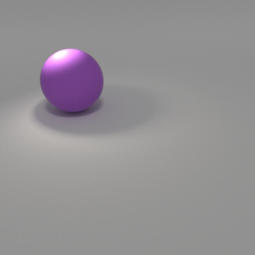
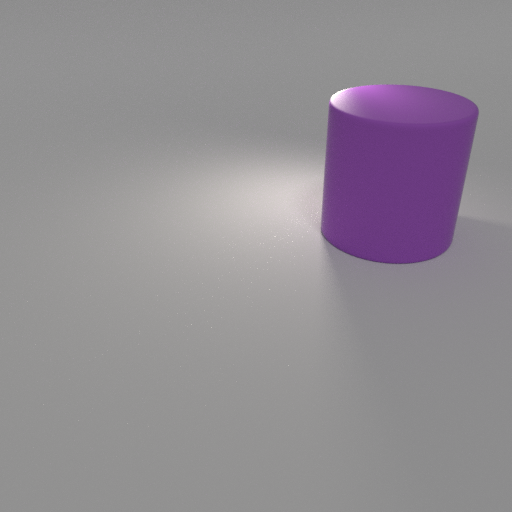
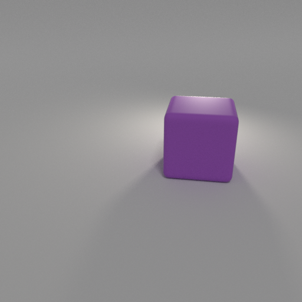
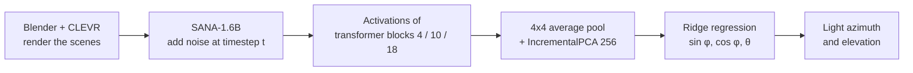
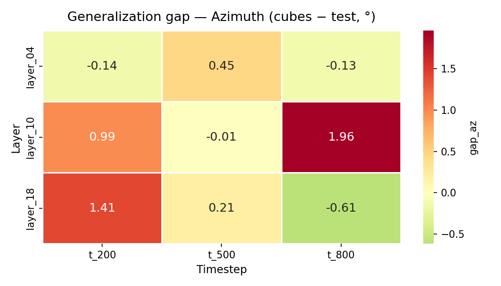
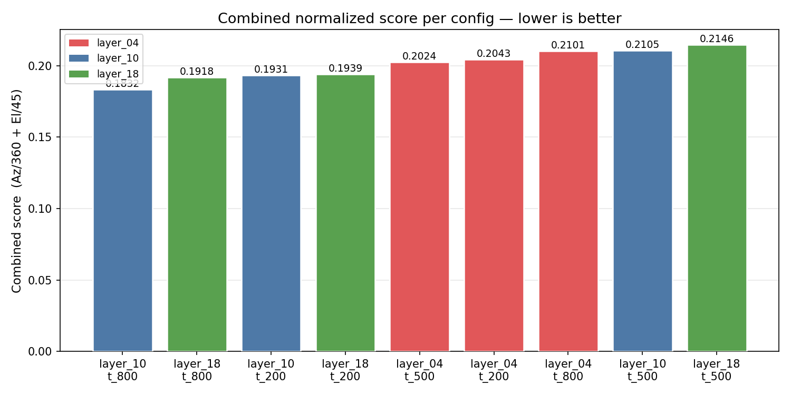

# 💡 Does Diffusion Learn 3D?

**Do text-to-image models build a 3D model of the world inside? A simple test with light and shadows.**

We render simple 3D objects with a known light direction. Then we give the images to the diffusion model **SANA-1.6B** and record the activations of its transformer. A **linear probe** on these frozen activations predicts the light direction. Then we test the probe on a new shape. If it also works there, the model encodes a physical property of the scene, not only 2D texture patterns.

<p align="center">
  
  
  
</p>

## 🎯 Result

**Yes. SANA-1.6B encodes the light direction, and a linear probe can read it.**

- The best probe (`layer_10`, timestep `t = 200`) predicts the light azimuth with a mean error of **14.0°** on cubes. A random guess has an error of **89.9°**.
- The probe learned only from spheres and cylinders. On cubes, the error increases by **less than 2°** in all 9 configurations.
- 256 PCA components are sufficient. With 512 or 1024 components, the probe overfits.

| Method (on `test_cubes`) | Azimuth MAE | Elevation MAE |
|---|---:|---:|
| Random guess | 89.86° | 14.61° |
| Always the mean of the train set | 88.87° | 11.35° |
| **Probe: Ridge + PCA256, `layer_10` / `t_200`** | **14.01°** | **6.94°** |

<p align="center">
  
  
  <br>
  <em>Green arrow: true light direction. Red arrow: probe prediction. Left: a correct prediction. Right: one of the worst errors.</em>
</p>

## 🔬 Method



1. **Dataset.** A modified [CLEVR](https://github.com/facebookresearch/clevr-dataset-gen) script renders one object in each scene with Blender 2.78c (Cycles). One key light has a known azimuth φ ~ U(0°, 360°) and elevation θ ~ U(30°, 75°). The fill and back lights are off. All objects are purple rubber, so color and reflections do not affect the result.
2. **Activations.** The DC-AE encoder of SANA-1.6B encodes each image. We add noise for one timestep and record the output of one transformer block with a forward hook. We use 3 blocks (4, 10, 18) and 3 timesteps (200, 500, 800), which gives 9 configurations.
3. **Dimension reduction.** A 4×4 average pool reduces the 32×32 token grid to 8×8 and keeps the spatial layout. IncrementalPCA reduces the features to 256 components. We fit it on the `train` split only.
4. **Probe.** A Ridge regression (α = 1.0) predicts `[sin φ, cos φ, θ]`. The sine and cosine pair handles the cyclic azimuth: φ̂ = atan2(ŝ, ĉ).

### Data split

The split uses the shape, not random samples, so the cubes are a true test of generalization.

| Split | Shapes | Images | Purpose |
|---|---|---:|---|
| `train` | spheres, cylinders | 1600 | train the probe |
| `val` | spheres, cylinders | 200 | select hyperparameters |
| `test` | spheres, cylinders | 200 | general evaluation |
| `test_cubes` | cubes | 1000 | test of generalization to a new shape |

### All configurations

Azimuth MAE on `test` and on `test_cubes` (a shape that the probe did not see before):

| Layer | t = 200 | t = 500 | t = 800 |
|---|---:|---:|---:|
| `layer_04` | 14.33° → 14.19° | 15.20° → 15.65° | 19.16° → 19.03° |
| `layer_10` | **13.01° → 14.01°** | 15.27° → 15.27° | 14.87° → 16.82° |
| `layer_18` | 13.42° → 14.84° | 14.67° → 14.88° | 18.27° → 17.65° |

<p align="center">
  
  
</p>

## 📁 Repository structure

```
├── clevr-dataset-gen/      # CLEVR generator with control of the light direction
├── dataset_generation/     # PowerShell scripts that render the dataset versions
├── data/
│   ├── final_example/      # sample of the final dataset (images + scene JSON)
│   ├── experiments/        # earlier versions of the dataset (v0–v44)
│   ├── splits/             # train / val / test / test_cubes CSV files
│   └── master_labels.csv   # light azimuth and elevation of each image
├── src/
│   ├── extract_activations.py   # forward hooks on SANA-1.6B
│   ├── prepare_data/            # labels and dataset splits
│   ├── probing/                 # PCA + Ridge probe, PCA and alpha analysis
│   └── test_cubes/              # evaluation on cubes, plots, prediction arrows
├── scripts/                # SLURM jobs for the Athena supercomputer
├── probe_exp/              # results: metrics, heatmaps, prediction plots
├── tests/                  # GPU check, extraction test, dataset notebook
└── docs/                   # project report (PDF, in Polish)
```

## 🚀 Reproduce

The full pipeline needs a GPU with approximately 16 GB of VRAM. We ran it on the Athena supercomputer (PLGrid) with SLURM.

1. Render the dataset with Blender 2.78c and the scripts in `dataset_generation/`.
2. Make the labels and the splits:
   ```bash
   python src/prepare_data/build_labels.py
   python src/prepare_data/build_splits.py
   ```
3. Extract the activations (SLURM array job):
   ```bash
   sbatch scripts/run_extract_activations_array.slurm
   ```
4. Train the probes and evaluate them on cubes:
   ```bash
   sbatch scripts/run_train_probe.slurm
   sbatch scripts/run_eval_test_cubes.slurm
   ```

> [!NOTE]
> The full dataset (3000 images) and the full activations (approximately 130 GB) are not in this repository. `data/final_example/` contains a small sample. The paths in `src/` and `scripts/` point to the project folder on Athena. Change them before you run the code on a different machine.

## 🛠 Tech stack

Python · PyTorch · Hugging Face `diffusers` · scikit-learn · NumPy · Matplotlib / Seaborn · Blender 2.78c · SLURM

## 📚 References

1. Johnson et al. *CLEVR: A Diagnostic Dataset for Compositional Language and Elementary Visual Reasoning.* CVPR 2017. [arXiv:1612.06890](https://arxiv.org/abs/1612.06890)
2. Xie et al. *SANA: Efficient High-Resolution Image Synthesis with Linear Diffusion Transformers.* 2024. [arXiv:2410.10629](https://arxiv.org/abs/2410.10629)
3. Chen et al. *Beyond Surface Statistics: Scene Representations in a Latent Diffusion Model.* 2023. [arXiv:2306.05720](https://arxiv.org/abs/2306.05720)
4. El Banani et al. *Probing the 3D Awareness of Visual Foundation Models.* CVPR 2024. [arXiv:2404.08636](https://arxiv.org/abs/2404.08636)
5. Surkov et al. *One-Step is Enough: Sparse Autoencoders for Text-to-Image Diffusion Models.* 2024. [arXiv:2410.22366](https://arxiv.org/abs/2410.22366)
6. Alain, Bengio. *Understanding intermediate layers using linear classifier probes.* 2016. [arXiv:1610.01644](https://arxiv.org/abs/1610.01644)

## 👥 Authors

**Natalia Choszczyk** and **Filip Langiewicz**: a project for the course *Advanced Topics in Neural Networks* (ZZSN) at the Warsaw University of Technology, 2026.

This research used the HPC resources of grant PLG/2025/019439 (PLGrid, Athena).
