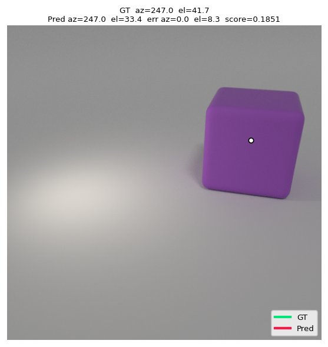
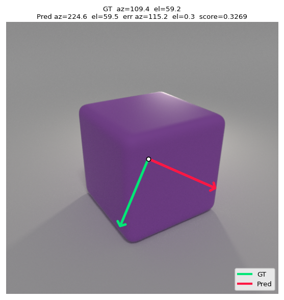

# Does Diffusion Learn 3D?

Do text-to-image models build a 3D model of the world inside? We test this with one simple property: the direction of the light.

We render simple objects with a known light direction and give the images to **SANA-1.6B**. A linear probe on the frozen transformer activations predicts the light azimuth and elevation. The probe learns on spheres and cylinders only. Then we test it on cubes.

<p align="center">
  
  
  <br>
  <em>Green: true light direction. Red: probe prediction. Left: a correct prediction. Right: one of the worst errors.</em>
</p>

## Result

SANA-1.6B encodes the light direction, and a linear probe can read it. On cubes, which the probe did not see before, the error increases by less than 2° in all 9 configurations.

| Method (on cubes) | Azimuth MAE | Elevation MAE |
|---|---:|---:|
| Random guess | 89.86° | 14.61° |
| Always the mean of the train set | 88.87° | 11.35° |
| **Probe (`layer_10`, `t = 200`)** | **14.01°** | **6.94°** |

## Method

1. **Dataset.** A modified [CLEVR](https://github.com/facebookresearch/clevr-dataset-gen) script renders one purple rubber object in each scene with Blender 2.78c. One light has a random azimuth (0°–360°) and elevation (30°–75°). There are 1000 images for each shape.
2. **Activations.** We add noise to each image at one timestep (200, 500 or 800) and record the output of transformer block 4, 10 or 18.
3. **Probe.** A 4×4 average pool and IncrementalPCA (256 components) reduce the features. A Ridge regression predicts `[sin φ, cos φ, θ]`, so the cyclic azimuth has no jump at 0°/360°.

The full report (in Polish) is in [`docs/`](docs/).

## Repository structure

```
clevr-dataset-gen/   CLEVR generator with control of the light direction
dataset_generation/  PowerShell scripts that render the dataset
data/                dataset sample, labels and train/val/test splits
src/                 activation extraction, probe training and evaluation
scripts/             SLURM jobs for the Athena supercomputer
probe_exp/           results: metrics, heatmaps and prediction plots
```

The full dataset and the activations (approximately 130 GB) are not in this repository. The code ran on the Athena supercomputer (PLGrid), and the paths in `src/` and `scripts/` point there.

## Authors

Natalia Choszczyk and Filip Langiewicz
