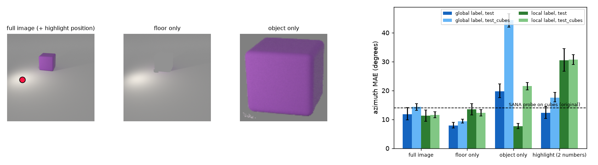
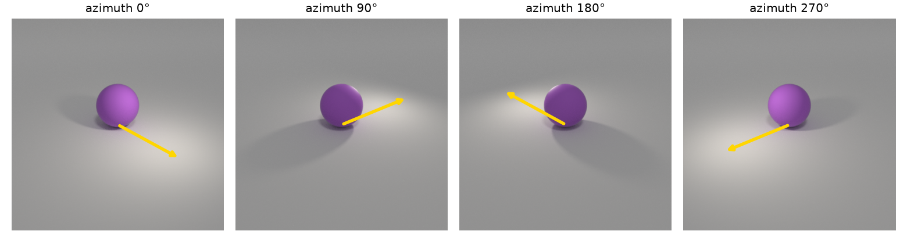
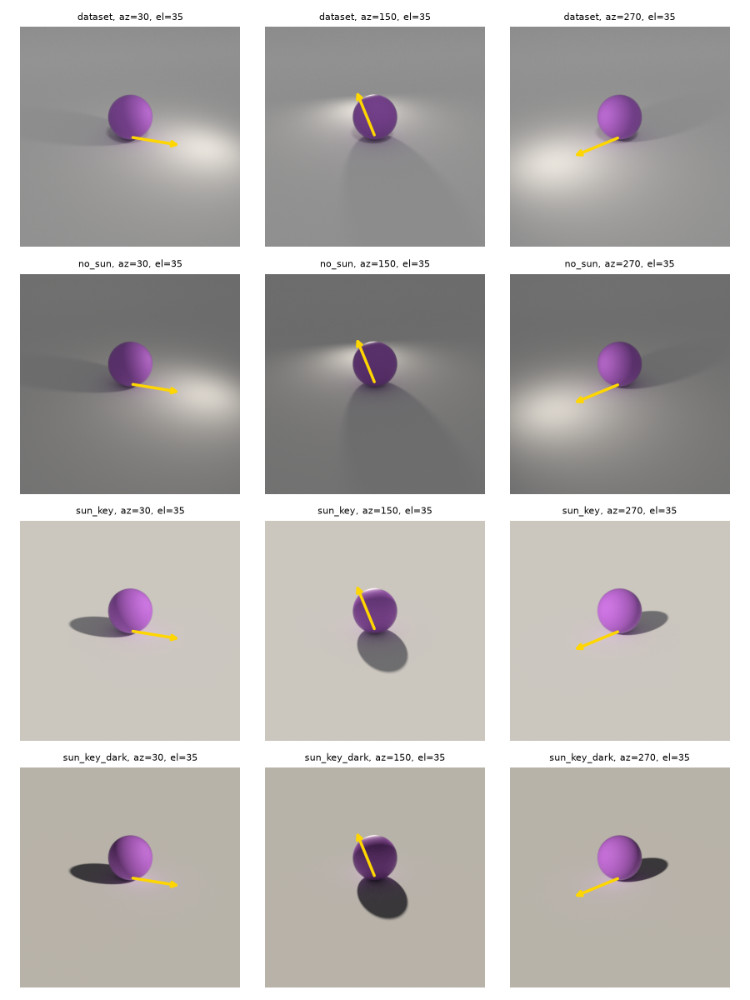
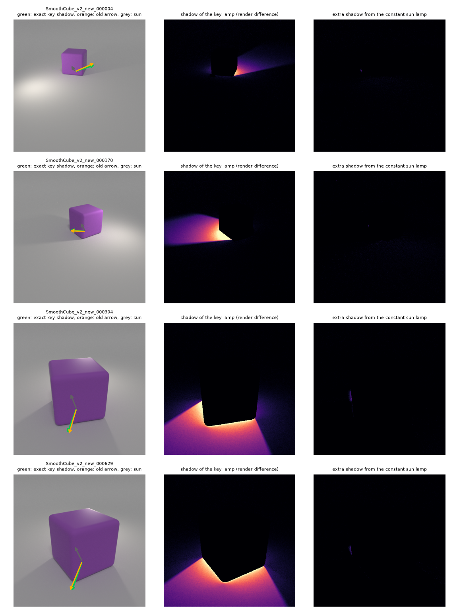
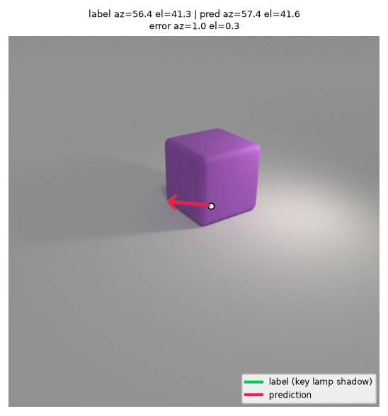
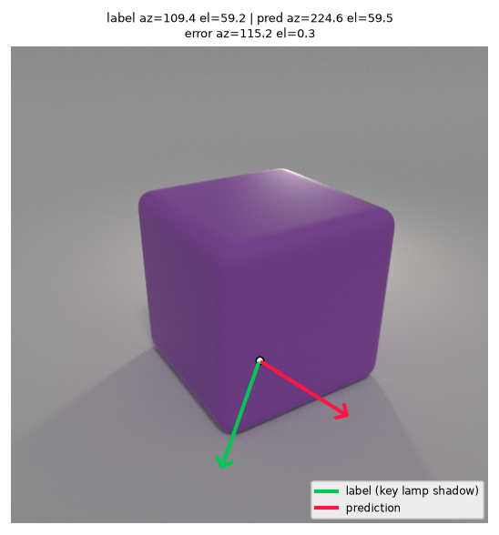
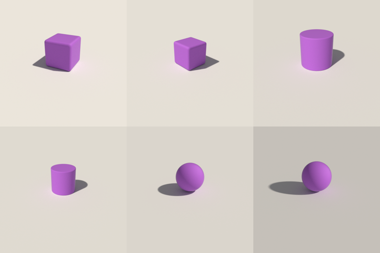

# Podsumowanie prac (stan na 13.10.2026)

Ten plik zbiera w jednym miejscu wszystko, co zostało sprawdzone i zrobione. Każdy rozdział odpowiada na jedno pytanie, podaje fakty z liczbami i pokazuje rysunek. Szczegóły techniczne (po angielsku) są w plikach podanych na końcu rozdziałów, ale nie trzeba ich czytać, żeby odpowiadać na pytania.

Cała praca jest na gałęzi `siwy-xai`. Gałąź `main` jest nietknięta i nic nie zostało wypchnięte na GitHub.

---

## 0. Najkrócej

1. **Wynik z ZZSN nie dowodzi tego, co twierdził.** Ta sama sonda na surowych pikselach obrazu (64×64) daje ten sam błąd co sonda na SANA: 14,1° wobec 14,0° na sześcianach.
2. **Sonda czyta podłogę, a nie obiekt.** Sama podłoga (z usuniętym obiektem) przewiduje etykietę lepiej niż cały obraz: 9,4° wobec 14,3° na sześcianach. Stąd „generalizacja na sześciany”: podłoga nie zależy od kształtu.
3. **Etykieta opisuje pozycję lampy wokół środka sceny, a nie światło przy obiekcie.** Różnica wynosi średnio 35° w azymucie.
4. **W ekstrakcji był błąd szumu.** Dla t = 200 model dostawał −24,5·x0 + 25,5·ε zamiast 0,8·x0 + 0,2·ε. Przyczyną jest pułapka w bibliotece diffusers, którą potwierdziłem i do której jest gotowa poprawka.
5. **Stare strzałki na rysunkach były niedokładne,** a ok. 18% z nich w ogóle się nie narysowało.
6. **W scenie były dodatkowe źródła światła,** a lampa robi dużą plamę na podłodze. Sprawdziłem warianty: jedna lampa typu SUN na płaskiej podłodze rozwiązuje problem.
7. **Projekt świetnie pasuje do SIWY (XAI):** krytyczna weryfikacja wyniku z kontrolami to dokładnie to, czego wymaga opis przedmiotu.

---

## 1. O co chodzi w projekcie

Pytanie badawcze brzmi: czy model tekst→obraz **SANA-1.6B** „wie”, skąd pada światło w scenie 3D?

Metoda z ZZSN:

1. Blender (zmodyfikowany generator CLEVR) renderuje jeden fioletowy obiekt (kula, walec, sześcian) i jedną lampę o losowym azymucie (0–360°) i elewacji (30–75°). Powstało 3000 obrazów, po 1000 na kształt.
2. Każdy obraz przechodzi przez enkoder SANA i dostaje szum dla kroku t (200, 500, 800). Z bloków transformera 4, 10 i 18 zapisywane są aktywacje.
3. Sonda liniowa (PCA 256 składowych + regresja Ridge) przewiduje [sin az, cos az, el].
4. Trening odbywa się na kulach i walcach, test na sześcianach, których sonda nie widziała.

Wynik z ZZSN: na sześcianach błąd azymutu (MAE) wynosi 14,0°, a elewacji 6,9° (blok 10, t = 200). Wniosek z raportu brzmiał: „SANA koduje kierunek światła jako fizyczną własność sceny”.

---

## 2. Czy wynik z ZZSN się broni?

**Nie.** Najprostsza kontrola go podważa. Tę samą sondę (PCA + Ridge, te same podziały danych) dopasowałem do **surowych pikseli obrazu**, bez żadnego modelu:

| Metoda (na sześcianach) | Błąd azymutu | Błąd elewacji |
|---|---:|---:|
| Losowe zgadywanie | 89,9° | 14,6° |
| Zawsze średnia z treningu | 88,9° | 11,4° |
| Sonda na SANA (ZZSN) | 14,0° | 6,9° |
| **Ta sama sonda na pikselach 64×64** | **14,1°** | **6,3°** |
| Ta sama sonda na pikselach 32×32 | 13,8° | 6,5° |

Na teście (kule i walce) piksele są nawet lepsze niż SANA: 11,5° wobec 13,0°.

**Co to znaczy:** informacja o świetle jest wprost w obrazie, w formie, którą liniowa sonda łatwo odczyta. Fakt, że sonda na SANA ją odczytuje, nie dowodzi, że SANA „rozumie” 3D. Może po prostu przenosić obraz dalej.

Ciekawostka: tę kontrolę planowaliście w dokumentacji wstępnej ZZSN („sonda na pikselach”), ale w raporcie końcowym jej nie było.

---

## 3. Skąd sonda bierze informację?

Sondę dopasowałem do czterech wersji każdego obrazu (cały obraz, tylko podłoga, tylko obiekt, położenie plamy światła):

| Wariant | Etykieta | Test (kule, walce) | Sześciany |
|---|---|---:|---:|
| cały obraz | globalna (z datasetu) | 11,8° | 14,3° |
| **sama podłoga** (obiekt usunięty) | globalna | **7,9°** | **9,4°** |
| sam obiekt (wycinek) | globalna | 19,8° | 44,3° |
| **dwie liczby: położenie jasnej plamy** | globalna | 12,2° | 17,6° |
| sam obiekt (wycinek) | lokalna (światło przy obiekcie) | 7,7° | 21,5° |

(W nawiasach kwadratowych w plikach są 95% przedziały ufności, np. sama podłoga na sześcianach: [8,8°; 10,0°].)

**Wnioski:**

- Etykietę z datasetu niesie **podłoga**: jasna plama od lampy i cień. Bez obiektu sonda działa nawet lepiej, bo obiekt tylko dokłada zmienność zależną od kształtu.
- **Dwie liczby** (gdzie na obrazie jest najjaśniejsze miejsce podłogi) dają prawie tyle samo co SANA.
- Sam obiekt (jego jasna i ciemna strona) dobrze mówi o świetle **przy obiekcie** dla znanych kształtów (7,7°), ale nie przenosi się na sześciany (21,5°).
- Czyli: „generalizacja na sześciany” z ZZSN wynika z podłogi, która nie zależy od kształtu, a nie z wiedzy 3D.

Pliki: `reports/experiments/pixel_cues/results.md`, kod: `src/dd3d/cues.py`, `scripts/experiments/pixel_cues.py`.

---

## 4. Jak dokładnie liczony jest azymut?

Odtworzyłem w Pythonie geometrię sceny z Blendera: kamerę, lampę i rzutowanie. Zgodność jest sprawdzona na dwa sposoby:

- model kamery odtwarza współrzędne pikselowe obiektu ze wszystkich 3000 plików JSON z dokładnością do **0,56 px**;
- ponowny render sceny z datasetu z tymi parametrami daje **ten sam obraz** (średnia różnica 0,14 na 255, maski obiektu pokrywają się w 98%).

Fakty:

- Lampa (`Lamp_Key`) stoi na sferze o promieniu 5 **wokół środka sceny**: x = 5·cos(el)·cos(az), y = 5·cos(el)·sin(az), z = 5·sin(el).
- Etykieta `light_azimuth_deg` to kąt tej pozycji lampy.
- Azymut rośnie **przeciwnie do ruchu wskazówek zegara**, także na obrazie. 0° to światło z prawej z przodu, 90° z prawej z tyłu, 180° z lewej z tyłu, 270° z lewej z przodu.
- **Rysunek 4.1 w raporcie ZZSN jest błędny**: mówi „zgodnie z ruchem wskazówek zegara”.

Na renderach widać od razu dużą jasną plamę na podłodze pod lampą. Przesuwa się razem z etykietą (o niej w rozdziale 6).

Kod: `src/dd3d/geometry.py`, testy: `tests/unit/test_geometry.py`.

---

## 5. Czy etykieta to kierunek światła przy obiekcie?

**Nie.** Lampa krąży wokół **środka sceny**, a obiekt stoi w losowym miejscu, nawet 2,8 jednostki od środka. Światło widziane z obiektu pada więc z innego kierunku niż etykieta:

- różnica w azymucie: średnio **35°** (mediana 27°, maksymalnie 180°, gdy lampa wisi „za” obiektem);
- różnica w elewacji: średnio **16°**; prawdziwa elewacja przy obiekcie mieści się w zakresie 8–89°, a nie 30–75°.

Sonda z ZZSN trafia w etykietę (14,0°), ale nie w kierunek światła przy obiekcie (35,5°). **Czyli czyta pozycję lampy w scenie, a nie światło padające na obiekt.** Pasuje to do rozdziału 3: pozycję lampy zdradza plama na podłodze.

Największe błędy sondy to głównie obrazy, w których etykieta najbardziej różni się od światła przy obiekcie. W 22 z 36 przypadków o błędzie powyżej 45° predykcja jest bliżej prawdziwego światła przy obiekcie niż etykiety.

---

## 6. Ile było źródeł światła i co daje ich zmiana?

W każdym obrazie datasetu świecą:

1. **Lamp_Key**: lampa powierzchniowa skierowana zawsze na środek sceny. Robi plamę na podłodze. Daje ok. 81% jasności podłogi i cały widoczny cień.
2. **„Area”**: czwarta lampa z oryginalnego CLEVR (typ SUN, stały kierunek: azymut 335°, elewacja 63°, prawie zza kamery). Skrypt wyłączał tylko Lamp_Fill i Lamp_Back, więc ta **zostawała włączona**. Jej cień jest niewidoczny, bo chowa się za obiektem, ale rozjaśnia obiekt z przodu.
3. **Światło tła**: białe „niebo” o sile 0,2, świecące ze wszystkich stron.

Plik `base_scene.blend` jest identyczny z oryginałem CLEVR (ta sama suma MD5), więc lampa „Area” pochodzi z CLEVR, a nie z waszych zmian.

**Dlaczego wyłączenie nie działało:** podłoże w CLEVR to nie płaska podłoga, tylko **zakrzywione tło studyjne**, które łukiem przechodzi w ścianę za sceną. Lampa SUN świecąca od tyłu jest zasłaniana przez tę ścianę i cała podłoga wpada w cień. Dodałem opcję płaskiej podłogi z tym samym materiałem.

Porównanie (kula w środku, 6 kierunków, średnie):

| Wariant | Plama na podłodze | Głębokość cienia | Kontrast na obiekcie | Błąd kierunku cienia |
|---|---:|---:|---:|---:|
| obecny dataset | 48,9 | 36 | 49 | 10,7° |
| tylko wyłączone „Area” | 58,5 | 47 | 52 | 10,0° |
| **lampa SUN + płaska podłoga** | **0,1** | **86** | **77** | **7,1°** |
| SUN + płaska podłoga + słabsze tło | 0,0 | 88 | 90 | 5,3° |

**Wniosek:** samo wyłączenie „Area” prawie nic nie zmienia, bo plama zostaje. Pomaga dopiero lampa typu SUN, czyli sam kierunek bez pozycji, na płaskiej podłodze. Wtedy jest jedno źródło światła, nie ma plamy, kierunek światła jest taki sam w każdym punkcie sceny, a etykieta jest dokładna dla obiektu.

Uwaga: przy lampie SUN średnia jasność podłogi zależy od elewacji. To poprawna fizyka, ale sonda na pikselach może z tego wyczytać elewację, więc kontrola na pikselach dalej jest potrzebna.

Kod: `tools/blender/render_spec.py` (opcje `key_type`, `flat_ground`), `scripts/audit/lighting_study.py`.

---

## 7. Czy predykcje są poprawnie liczone?

**Tak.**

- Dekodowanie azymutu `atan2(sin, cos) mod 360` jest poprawne.
- Błąd azymutu liczony jest „kołowo”: `min(|d|, 360 − |d|)`, czyli 1° i 359° różnią się o 2°. To też jest poprawne.
- Kolejność wierszy cech i etykiet się zgadza (sonda na pikselach z tymi samymi plikami daje błędy tej samej wielkości).

Problem nie leży więc w liczeniu, tylko w tym, **co** jest etykietą (rozdział 5) i **co** sonda czyta (rozdział 3).

Dwie mniejsze usterki w sondzie z ZZSN:

- **Alfa w Ridge niczego nie zmieniała:** błąd był identyczny dla alfa od 0,001 do 1000, bo siatka była o rzędy wielkości za mała względem wariancji składowych PCA. Nowa sonda dobiera alfę z siatki dopasowanej do danych, tylko na zbiorze walidacyjnym.
- Konfigurację końcową wybierano częściowo patrząc na zbiory testowe. Nowy kod używa do wyboru tylko walidacji i podaje przedziały ufności.

---

## 8. Czy strzałki na rysunkach były dobre?

**Nie do końca.** Sprawdziłem wszystkie 3000 scen:

- skrypt używał **domyślnej kamery Blendera**, a nie kamery CLEVR, i pomijał jej losowe przesunięcie;
- rzutował kierunek bez perspektywy, więc średni błąd kierunku strzałki wynosił 5,2°, w 16% scen ponad 10°, maksymalnie 34°;
- strzałki miały stałą długość 143 px od środka obiektu, a matplotlib **nie rysuje strzałki, która kończy się poza obrazem**, więc **ok. 18–19% strzałek w ogóle nie ma na rysunkach**;
- strzałki pokazują **kierunek cienia** (od lampy), a README mówił „kierunek światła”;
- stała długość strzałki nie pokazuje elewacji.

Sprawdziłem to na prawdziwych cieniach. Wyrenderowałem sceny bez obiektu i odjąłem obrazy, co dało dokładną mapę cienia. Przy długich cieniach nowa strzałka myli się średnio o 4,7°, stara o 7,6°.

Nowe strzałki (`dd3d viz`) używają dokładnej kamery każdego obrazu i biegną od podstawy obiektu do cienia jego środka, więc długość pokazuje elewację. Są też przycinane do krawędzi obrazu.

| Dobra predykcja | Jeden z najgorszych błędów |
|---|---|
|  |  |

Zielona strzałka to etykieta, czerwona to predykcja. Po prawej widać, że sonda pomyliła się o 115°.

Raport szczegółowy: `docs/audit/labels_and_arrows.md`.

---

## 9. Błąd szumu i biblioteka diffusers

### Czym jest diffusers?

**diffusers** to biblioteka Hugging Face, przez którą wczytujecie SANA (`SanaPipeline`). Częścią pipeline'u jest **scheduler**, obiekt, który mówi, ile szumu ma być na danym kroku t. Funkcja `scheduler.add_noise(x0, szum, t)` miesza czysty obraz z szumem w proporcji właściwej dla kroku t.

### Co było nie tak?

SANA jest modelem przepływowym (`flow matching`). Na kroku t oczekuje wejścia

  x_t = (1 − t/1000)·x0 + (t/1000)·ε,  czyli dla t = 200: 0,8·x0 + 0,2·ε.

W ZZSN wywołaliście `add_noise` **zanim** scheduler dostał `set_timesteps`. W takim stanie scheduler `DPMSolverMultistepScheduler` ma tablicę poziomów szumu w **odwrotnej kolejności i w złym formacie**, więc dla t = 200 bierze wartość dla kroku 799. Model dostawał:

| t | co dostawał model (ZZSN) | co powinien dostać |
|---:|---|---|
| 200 | −24,5·x0 + 25,5·ε (norma 35× za duża, obraz odwrócony) | 0,8·x0 + 0,2·ε |
| 500 | −2,4·x0 + 3,4·ε | 0,5·x0 + 0,5·ε |
| 800 | 0,28·x0 + 0,72·ε (prawie dobrze) | 0,2·x0 + 0,8·ε |

Zapisane aktywacje z ZZSN się z tym zgadzają: w bloku 4 średnia norma tokenu wynosi ok. 11 100 dla t = 200 i ok. 720 dla t = 800. Oś „timestep” w wynikach ZZSN jest więc błędna, a t = 200 i t = 500 to wejścia, jakich model nigdy nie widział w treningu.

### Repozytorium i proponowane zmiany

- Repozytorium: https://github.com/huggingface/diffusers (licencja **Apache-2.0**, czyli open source; ok. 34 700 gwiazdek).
- Zmiana dotyczy 4 plików, w każdym tej samej linii w `__init__`, gdzie tworzona jest tablica `self.sigmas`:
  - `src/diffusers/schedulers/scheduling_dpmsolver_multistep.py`
  - `src/diffusers/schedulers/scheduling_dpmsolver_singlestep.py`
  - `src/diffusers/schedulers/scheduling_unipc_multistep.py`
  - `src/diffusers/schedulers/scheduling_deis_multistep.py`
- Treść zmiany:
  - **zwykłe (VP) schedulery:** tablica dostaje odwrotną kolejność (`.flip(0)`), żeby `sigmas[i]` pasowało do `timesteps[i]`, które idą od 999 do 0;
  - **tryb flow (`use_flow_sigmas`, np. SANA):** zamiast złego formatu VP jest `sigma = t / 1000`, czyli dokładnie to, co daje `set_timesteps`.
- Do tego 3 nowe testy w `tests/schedulers/test_scheduler_dpm_multi.py`.
- Razem 5 plików, +104 i −4 linie. Plik z różnicami: `tools/diffusers_upstream/fix.patch`.
- `add_noise`, `set_timesteps` i `step` pozostają bez zmian, więc zwykłe generowanie działa identycznie jak dotąd.

### Czy to na pewno błąd i czy poprawka działa?

**Wersja:** sprawdzone na najnowszym wydaniu z PyPI (**0.41.0**) i na najnowszym `main` (commit `916a579` z 13.10.2026). Od wcześniejszego klonu doszły tylko 2 commity, które nie dotykają schedulerów.

**Test na prawdziwych modelach.** Model dostaje obraz zaszumiony przez scheduler i ma odtworzyć czysty obraz. Mniejszy błąd jest lepszy. Wzorcem jest poprawny poziom szumu.

Mały model VP (`google/ddpm-cifar10-32`); wzorzec to `DDPMScheduler`, prosty scheduler, który robi ten krok poprawnie:

| t | wzorzec | 4 schedulery bez poprawki | 4 schedulery z poprawką |
|---:|---:|---:|---:|
| 100 | 0,045 | **0,590** | 0,045 |
| 300 | 0,115 | **0,294** | 0,115 |
| 500 | 0,191 | 0,190 | 0,191 |

**SANA 1.6B, wasz model** (Kaggle, GPU T4, float32, skrypt `repro_sana.py`); wzorzec to wzór (1 − t/1000)·x0 + (t/1000)·ε:

| t | wzorzec | diffusers bez poprawki | diffusers z poprawką |
|---:|---:|---:|---:|
| 200 | 0,180 | **36,6** | 0,180 |
| 500 | 0,379 | **4,62** | 0,379 |
| 800 | 0,624 | 0,601 | 0,624 |

**SANA 600M 512 px** (ta sama rodzina, float32, CPU laptopa):

| t | wzorzec | diffusers bez poprawki | diffusers z poprawką |
|---:|---:|---:|---:|
| 200 | 0,228 | **45,5** | 0,228 |
| 500 | 0,383 | **5,76** | 0,383 |
| 800 | 0,590 | 0,556 | 0,590 |

Z poprawką wyniki są identyczne ze wzorcem. Bez niej model przy małym t dostaje wejście, z którego nie da się odtworzyć obrazu.

**Testy biblioteki:** na najnowszym `main` z poprawką przechodzi 276 testów schedulerów. Bez poprawki failują tylko 3 nowe testy, a 270 istniejących przechodzi, więc niczego nie psuję.

**Ograniczenie:** dwa inne schedulery (SASolver i DPMSolverMultistepInverse w trybie flow) mają podobny problem i poprawka ich nie obejmuje. Jest to opisane w zgłoszeniu.

### Dlaczego nikt tego nie zauważył, skoro to popularna biblioteka?

- Każdy standardowy pipeline (generowanie, img2img, inpainting) najpierw wywołuje `set_timesteps`, a dopiero potem `add_noise`. W tej kolejności wszystko działa poprawnie.
- Błąd wychodzi tylko przy `add_noise` wywołanym od razu po wczytaniu schedulera. Robią tak skrypty treningowe i badania typu sondowanie, takie jak wasze w ZZSN.
- Oficjalne skrypty treningowe używają innych schedulerów (`DDPMScheduler`, `FlowMatchEulerDiscreteScheduler`).
- Tablica `sigmas` w `__init__` pojawiła się w PR #6006 (2023), żeby ta kolejność wywołań przestała kończyć się wyjątkiem. Wyjątek zniknął, ale nikt nie sprawdził, czy wartości są dobre.

### Czy ktoś to już zgłosił albo naprawiał?

Przeszukałem issue i PR w diffusers (otwarte i zamknięte) przez API GitHuba, kilkunastoma zapytaniami.

- Ten sam obszar kodu, ale inny problem:
  - #5158: zamknięte, zmieniło `add_noise`, żeby czytało `sigmas`;
  - #5981: zamknięte, wyjątek „brak atrybutu sigmas”;
  - #6006: scalone, dodało `sigmas` w `__init__` i spowodowało ten błąd.
- Zgłoszenia o odwróconej kolejności albo złym poziomie szumu nie znalazłem. Nie znalazłem też otwartego PR, który zmienia te linie.
- Inne otwarte PR przy tych schedulerach dotyczą innych rzeczy, np. #14356, #13450 i #14572.
- Zastrzeżenie: to przeszukanie wyszukiwarką GitHuba, a nie ręczne przeczytanie wszystkich ok. 15 000 zgłoszeń. Przed wysłaniem warto jeszcze raz sprawdzić na stronie.

Skrypty tych testów: `tools/diffusers_upstream/functional/`.

**Czy PR daje 5 z przedmiotu? Nie da się tego stwierdzić z samego regulaminu, trzeba zapytać prowadzącego.** §1 pkt 4 mówi: „Wystawienie PR zawierającej sensowną kontrybucję do wybranego projektu open source automatycznie skutkuje oceną 5 z przedmiotu”. Otwarte pytania:
- czy wystarczy wystawienie PR, czy musi zostać przyjęty;
- czy PR liczy się dla całego zespołu, czy tylko dla autora;
- czy zwalnia z kolokwiów (regulamin tego nie mówi);
- czy ta poprawka to dla prowadzącego „sensowna kontrybucja”.

**Stan (13.10.2026):** zgłoszenie jest wysłane: https://github.com/huggingface/diffusers/issues/15021. PR czeka na odpowiedź opiekunów. Gotowy tekst: `tools/diffusers_upstream/PR.md`.

---

## 10. Propozycja nowego datasetu (v2)

Zasady (generator: `scripts/data/make_v2_spec.py`):

- **jedno źródło światła**: lampa typu SUN, czyli sam kierunek, więc etykieta jest dokładna dla obiektu;
- lampa „Area” wyłączona;
- płaska podłoga zamiast zakrzywionego tła, bez plamy;
- **obiekt w środku sceny**, losowe tylko wielkość (0,8–1,4) i obrót (poprawnie w radianach);
- kamera bez losowego przesunięcia;
- osobny mały zbiór testowy z obiektem w innych miejscach (opcja `--random-position`), żeby sprawdzić, czy wynik nie zależy od pozycji;
- etykiety zapisywane razem z parametrami renderu (`labels.csv`).

Próbka (6 obrazów):

Czas: ok. 25 s na obraz na tym laptopie, czyli ok. 21 h dla 3000 obrazów. Na węzłach CPU klastra dużo szybciej.

---

## 11. Co zostało zrobione w repozytorium

| Element | Gdzie | Status |
|---|---|---|
| Pakiet Pythona `dd3d` (geometria, szum, ekstrakcja, sonda, wskazówki, rysunki, CLI) | `src/dd3d/` | gotowe |
| Poprawiona ekstrakcja (dobry szum, stałe ziarno, maska promptu, zapis 287 KB zamiast 9,2 MB na obraz) | `src/dd3d/extract.py`, `configs/` | gotowe, nieprzetestowane na GPU |
| Joby SLURM pod nową ekstrakcję + kontrole | `scripts/slurm/` | gotowe |
| Testy jednostkowe (34, ok. 10 s, bez GPU) | `tests/unit/` | przechodzą |
| ruff, Makefile, pre-commit, konwencjonalne commity | katalog główny | gotowe |
| Skrypt Blendera renderujący dowolną scenę z JSON | `tools/blender/render_spec.py` | gotowe |
| Audyt etykiet, strzałek i oświetlenia | `docs/audit/labels_and_arrows.md`, `reports/audit/` | gotowe |
| Eksperyment wskazówek na pikselach | `reports/experiments/pixel_cues/` | gotowe |
| Design proposal z harmonogramem w datach (wymóg SIWY) | `docs/design_proposal.md` | szkic do przejrzenia |
| Tabela literatury, 31 prac (wymóg SIWY) | `docs/literature.md` | gotowe |
| Instrukcja użytkowania (wymóg SIWY) | `docs/usage.md` | gotowe |
| Dziennik tygodniowy (wymóg SIWY) | `docs/worklog.md` | pierwszy wpis |
| Szkic artykułu (TMLR, anonimowy) | `docs/article/main.tex`, PDF w `docs/article/build/` | szkic, brakuje wyników z GPU |
| Lista konferencji i terminów | `docs/article/venues.md` | gotowe |
| Stary kod z ZZSN | `legacy/` | przeniesiony bez zmian |

Uruchamianie: `make install`, `make test`, `make audit`, `make cues`; wszystkie komendy: `.venv/bin/dd3d --help`.

---

## 12. Artykuł

- **Teza:** sondy liniowe na modelu dyfuzyjnym łatwo dają fałszywy dowód „wiedzy 3D”. Pokazujemy to na przykładzie z kontrolami, audytem i listą kontrolną dla innych badań. Wynik negatywny też jest tu wartościowy.
- **Gdzie wysłać** (`docs/article/venues.md`):
  - **TMLR**: zgłoszenia przyjmowane cały czas, więc najłatwiej spełnić warunek SIWY „rozpocząć zgłaszanie w trakcie semestru”;
  - IJCNN 2027 (termin 31.01.2027);
  - warsztaty ICLR 2027 (ok. 1.02.2027).
- **Czego brakuje:** wyników z poprawionej ekstrakcji na GPU (pełny przegląd bloków i kroków, kontrola z losowymi wagami, dataset v2) oraz testów przyczynowych (usunięcie konceptu LEACE, sterowanie). W PDF są oznaczone na czerwono jako `[pending]`.

---

## 13. Sprzęt i klaster

- **Ten laptop (Ryzen 5 2500U, 8 wątków, 5,4 GB RAM dla WSL)** wystarcza do audytów, sond, wskazówek, testów i Blendera.
- **SANA na tym laptopie się nie da**:
  - w bfloat16 procesor nie ma sprzętowego wsparcia i obliczenia stoją; test mnożenia macierzy nie skończył się w kilka minut, a w float32 trwa 0,3 s;
  - w float32 model ma 6,4 GB i nie mieści się w pamięci.
- **Klaster (do listopada):** pierwsze w kolejce są poprawiona ekstrakcja v1 i kontrole (`scripts/slurm/README.md`), potem ekstrakcja v2. Całe GPU trzeba skończyć przed wygaśnięciem dostępu.
- **Przerwy sesji w nocy i w dzień** to restart całego WSL (uśpienie lub restart Windowsa), a nie błąd w pracy. Na przyszłość: ustawić w Windowsie „nie usypiaj na zasilaczu” i „zamknięcie klapy: nic nie rób”.

---

## 14. Decyzje do podjęcia

1. **Dataset v2:** czy przyjmujecie zasady z rozdziału 10? Do ustalenia:
   - siła światła tła: 0,2 (miękkie cienie, naturalnie) czy 0,05 (większy kontrast);
   - zakres elewacji: proponuję 20–70°.
2. **Gdzie renderować v2:** laptop (ok. 21 h, laptop nie może zasnąć) czy klaster CPU.
3. **Zgłoszenie do diffusers:** czy wysyłacie issue i PR (rozdział 9)?
4. **Termin dostępu do klastra:** od niego zależy cały plan GPU.
5. **Sprawy z prowadzącym:**
   - zespół ma być 3-osobowy, a jesteście we dwoje;
   - potrzebna zgoda na kontynuację projektu z ZZSN, z jasnym podziałem, co jest nowe.
6. **Scalenie `siwy-xai` do `main` i wypchnięcie na GitHub?**

---

## 15. Mapa plików

| Chcesz zobaczyć… | Otwórz |
|---|---|
| ten przegląd | `docs/PODSUMOWANIE.md` |
| szczegóły audytu (angielski) | `docs/audit/labels_and_arrows.md` |
| plan dla prowadzącego | `docs/design_proposal.md` |
| szkic artykułu | `docs/article/build/main.pdf` |
| zgłoszenie do diffusers | `tools/diffusers_upstream/` |
| liczby z eksperymentów | `reports/` |
| jak uruchamiać | `docs/usage.md` |
| literaturę | `docs/literature.md` |
