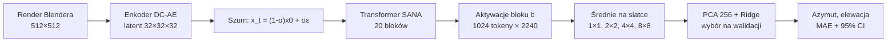
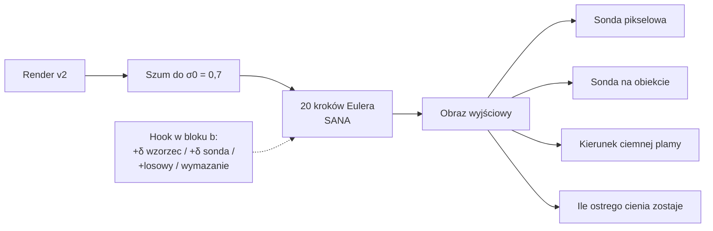

# Wyniki projektu: czy SANA „wie”, skąd pada światło?

> **To jest jedyne źródło prawdy o wynikach projektu.** Każda liczba ma obok ścieżkę do pliku wyników w `reports/experiments/`. Jak powstaje każdy plik (job na Kaggle, skrypt): [`REPRODUCE.md`](REPRODUCE.md). Historia pracy i odchylenia od planu: [`worklog.md`](worklog.md). Audyt z 17.10.2026, który poprawił część wniosków: [`audit/validation_2026-10-17/RAPORT.md`](audit/validation_2026-10-17/RAPORT.md).
>
> Stan: 17.10.2026, gałąź `fix/audit-findings`; wszystkie joby z Kaggle są zakończone i zsynchronizowane.

---

## 1. Pytanie i metoda

Czy aktywacje modelu tekst→obraz **SANA-1.6B** zawierają kierunek światła sceny w formie, której **liniowa sonda nie znajdzie w samych pikselach**? Czy model tej informacji **używa** przy generowaniu obrazu?

Narzędziem jest liniowa sonda (PCA, potem regresja Ridge) na uśrednionych aktywacjach bloku $b$ transformera przy kroku szumu $t$:

$$
\hat{\mathbf y} = W\,\mathrm{PCA}_{256}\big(h_b(x_t)\big) + c,
\qquad
\mathbf y = [\sin\varphi,\ \cos\varphi,\ \theta],
\qquad
\hat\varphi = \operatorname{atan2}(\hat y_1, \hat y_2)
$$

gdzie $\varphi$ to azymut, a $\theta$ elewacja światła. Błąd azymutu liczymy kołowo: $e = \min(|\hat\varphi-\varphi|,\ 360^\circ - |\hat\varphi-\varphi|)$, więc zgadywanie daje średnio 90°. Model dostaje obraz zaszumiony regułą przepływu, na której był trenowany: $x_t = (1-\sigma)\,x_0 + \sigma\,\varepsilon$, $\sigma = t/1000$.

Każdy wynik ma te same kontrole:

- piksele obrazu (siatka 8, 16, 32 albo 64 px, wybrana na walidacji),
- latent DC-AE,
- SANA z losowymi wagami,
- zadanie kontrolne z przetasowanymi etykietami,
- dwa inne modele dyfuzyjne (SD 1.5, SDXL),
- dwa modele, które **nie generują obrazów** (DINOv2-L, CLIP ViT-L/14).

Blok, krok $t$ i siatkę wybiera wyłącznie zbiór walidacyjny. Sonda uczy się na kulach i walcach, a test jest też na sześcianach, których sonda nie widziała.

**Czego sonda nie rozstrzyga.** Przewaga nad liniową sondą na pikselach pokazuje, że model ma kierunek światła w prostej, liniowej formie. Nie pokazuje sama z siebie, że to „wiedza 3D”: jasna i ciemna strona obiektu oraz kierunek cienia to też wzorce 2D. Dlatego są kontrole z modelami niegeneratywnymi (sekcja 4) i testy przyczynowe (sekcje 7–8).

---

## 2. Zbiory danych

| Zbiór | Co się zmienia | Obrazy | Do czego |
|---|---|---:|---|
| v1 | dane ZZSN: lampa obszarowa wokół środka sceny, plama światła na podłodze, dodatkowa lampa | 3000 | audyt |
| v2 | jedna lampa słoneczna (sam kierunek), płaska podłoga, obiekt w środku | 3000 | sondy, testy przyczynowe |
| v2ns | v2 bez cienia rzucanego | 3000 | sprawdzenie wskazówek |
| v2pos | v2 z obiektem w losowym miejscu (inne sceny) | 300 | test sond z v2 |
| v2r | v2 z obiektem w losowym miejscu (te same sceny) | 3000 | główny test sond |
| v2rns | v2r bez cienia rzucanego | 3000 | wariant wskazówek |
| v2rso | v2r z obiektem niewidocznym dla kamery; cień zostaje | 3000 | wariant wskazówek |
| v2rot | 48 scen testowych v2 ze światłem obróconym o +90° | 48 | łatanie |

Podziały są takie same we wszystkich zbiorach: 1600 kul i walców do nauki, 200 do walidacji, 200 do testu i 1000 sześcianów. W v2rns i v2rso obiekt nadal odbija fioletowe światło na podłogę, więc te warianty nie rozdzielają wskazówek do końca (sekcja 5). Obrazy są tylko na Kaggle; w repo są etykiety, podziały i przykłady:

---

## 3. Audyt projektu ZZSN

| Ustalenie | Liczby | Plik |
|---|---|---|
| Stary wynik **nie bił pikseli** | sześciany: SANA 14,0°, ta sama sonda na pikselach 64×64 14,3°, 32×32 14,1°, siatka wybrana na walidacji (16×16) 12,8° | `v1/best/predictions.csv`, `probe_exp/` |
| W starym kodzie **szum był błędny** (pułapka w diffusers, zgłoszona jako issue 15021) | dla t = 200 model dostawał −24,5·x0 + 25,5·ε zamiast 0,8·x0 + 0,2·ε | `tools/diffusers_upstream/ISSUE.md` |
| Etykieta to **pozycja lampy**, a nie światło przy obiekcie | różnica średnio 35° w azymucie | `docs/audit/labels_and_arrows.md` |
| Sondę niosła **plama światła na podłodze** | sama podłoga 9,4°, sam obiekt 44,3° (sześciany) | `pixel_cues/results.md` |
| Stara konfiguracja była **wybrana na danych testowych**, a alfa Ridge nie miała wpływu | ten sam błąd dla alfa od 0,001 do 1000 | `probe_exp/ridge_alpha_analysis/` |

**Błąd szumu w skrócie.** Stary kod wywoływał `scheduler.add_noise` przed `set_timesteps`. W takim stanie scheduler SANA ma poziomy szumu w odwrotnej kolejności i w złym formacie, więc dla t = 200 bierze wartość dla kroku 799. Wejście miało przez to normę ok. 35 razy większą od szumu i odwrócony obraz. Zapisane aktywacje ZZSN to potwierdzają (średnia norma tokenu w bloku 4: ok. 11 100 przy t = 200; z poprawnym szumem 718). Szczegóły i testy: `tools/diffusers_upstream/ISSUE.md`, `NOTES.md`.

**Poprawiony pipeline na starych danych (v1):** SANA daje **4,8°** na sześcianach, najlepsze piksele 12,8°. Ze starym szumem wychodzi 14,5°, czyli stary wynik się odtwarza. To błędny szum ukrył informację, którą model ma. Dane v1 mają jednak nadal plamę na podłodze, więc ten wynik sam nie dowodzi kodu światła przy obiekcie.

---

## 4. Sondy: kierunek światła jest w cechach, a nie w liniowym odczycie pikseli

Błąd azymutu (°) na teście (kule i walce) / na sześcianach. Konfiguracja wybrana na walidacji. Pełna tabela z 95% przedziałami: [`reports/experiments/rq1.md`](../reports/experiments/rq1.md).

| Cechy | v1 | v2 | v2r | v2rns (bez cienia) | v2rso (sam cień) |
|---|---|---|---|---|---|
| Piksele (siatka wybrana na walidacji) | 9,6 / 12,8 | 2,5 / 13,7 | 21,5 / 20,1 | 24,6 / 23,3 | 24,6 / 16,9 |
| Latent DC-AE | 7,3 / 8,9 | 2,2 / 9,2 | 18,8 / 19,0 | 29,0 / 30,7 | 15,7 / 17,8 |
| SANA, losowe wagi | 11,5 / 11,9 | – | 11,9 / 15,9 | – | – |
| SANA, stary szum | 12,4 / 14,5 | – | – | – | – |
| **SANA-1.6B** | **4,1 / 4,8** | **2,2 / 7,3** | **5,4 / 7,6** | **6,9 / 9,9** | **5,9 / 7,9** |
| SD 1.5 | 5,1 / 6,9 | 3,3 / 8,9 | 7,5 / 11,1 | – | – |
| SDXL | 5,4 / 6,0 | – | 5,9 / 7,3 | – | – |
| DINOv2-L (bez generowania) | 3,0 / 4,1 | 1,7 / 8,0 | 3,3 / 10,0 | 4,7 / 14,1 | 3,4 / 7,8 |
| CLIP ViT-L/14 (bez generowania) | 3,0 / 4,4 | 1,6 / 8,0 | 3,9 / 16,0 | 5,1 / 19,5 | 4,4 / 7,2 |

Myślnik oznacza, że tej kontroli nie liczyliśmy na danym zbiorze.

Wnioski:

1. **Na v2r SANA jest lepsza od najlepszych pikseli o 12,5°** na sześcianach (CI [11,1; 13,8]). SD 1.5 i SDXL dają podobny efekt.
2. **Część efektu daje sama architektura:** SANA z losowymi wagami też bije piksele (15,9° wobec 20,1°). Trening zmniejsza ten błąd mniej więcej o połowę.
3. **Liniowo czytelny kierunek światła nie jest cechą modelu generatywnego.** DINOv2 i CLIP nie generują obrazów, a na znanych kształtach są lepsze od SANA na każdym zbiorze (o 0,5–2,5°, przedziały sparowane nie obejmują zera). Na sześcianach SANA jest wyraźnie lepsza tylko tam, gdzie obiekt się przesuwa i widać jego cieniowanie: na v2r o 2,4° od DINOv2 i o 8,4° od CLIP, a na v2rns o 4,2° i 9,6°. Na pozostałych zbiorach, też na v2rso (sam cień), różnice są poniżej 1° w obie strony. Zastrzeżenie: DINOv2 i CLIP dostają obraz 224 px, a SANA 1024 px. Plik: `<zbiór>/best/predictions.csv`.
4. **Najlepsze są wczesne i środkowe bloki (4–10) przy najmniejszym szumie** (t = 100), czyli przy prawie czystym obrazie.
5. Zadanie kontrolne (przetasowane etykiety) daje średnio 82–98°, więc sondy nie dopasowują szumu.

---

## 5. Gdzie jest informacja: pozycja i wskazówki

**Pozycja.** Sonda na średniej wszystkich tokenów (siatka 1×1) daje na v2r 5,9° / 13,2°. Sonda uczona tylko na obiektach w środku (v2) daje na obiektach w losowych miejscach (v2r) 9,0° / 17,6°, a piksele 71°. Kod kierunku **w dużej mierze nie zależy od pozycji**, ale przeniesienie nie jest pełne: na sześcianach traci 4,4° wobec sondy uczonej na v2r. Pliki: `transfer/pos/transfer.md`, `transfer/cue_pooled/transfer.md`.

Ten sam test dla modeli bez generowania (sonda na średniej wszystkich tokenów, uczona na v2, test na v2r): DINOv2 6,8° / 21,5°, CLIP 8,0° / 19,0°, SANA 9,0° / 17,6°. Kod niezależny od pozycji mają więc wszystkie trzy modele (`transfer/pos_vision/transfer.md`).

**Wskazówki.** Bez cienia rzucanego (v2rns) SANA daje 6,9° / 9,9°, a z samym cieniem (v2rso) 5,9° / 7,9°; najlepsze piksele 24,6° / 23,3° i 24,6° / 16,9°. Model ma więc kierunek światła i bez cienia, i bez widocznego obiektu. Oba warianty zachowują jednak światło odbite przez obiekt na podłogę, a ta wskazówka jest silna (na v2ns sama podłoga daje 4,6°). Test nie oddziela więc cieniowania od tej słabej wskazówki. Sonda z pełnych scen przenosi się na sceny z jedną wskazówką częściowo (30–33° na teście; piksele 73–75°).

**Mapy sondy.** Rozkład wag sondy na komórki 8×8 nie odróżnia modeli: sonda SANA i sonda na pikselach dają obiektowi i cieniowi ok. 1,4 raza więcej wagi niż ich udział w powierzchni (`v2r/maps/regions.md`).

---

## 6. Jak mierzymy światło na obrazie wyjściowym

Testy przyczynowe oceniają obraz wyjściowy czterema miarami. Skalę każdej miary daje kalibracja na renderach ze znanym światłem (`reports/experiments/measures/measures.md`):

| Miara | Błąd na renderach v2: test (sześciany), mediana | Odczyt dla światła obróconego o +90° (v2rot, mediana) |
|---|---|---|
| sonda pikselowa | 1,7° (10,7°) | +90,7° |
| sonda na obiekcie | 2,6° (20,6°) | +89,1° |
| kierunek ciemnej plamy | 6,4° (8,7°) | +83,5° |
| ile ostrego cienia zostaje | – | 0,07 (ten sam obraz: 1,00) |

Wszystkie cztery miary widzą więc pełny obrót o 90° na renderach. Sonda na obiekcie ma na obrazach generowanych większy błąd niż na renderach: pełny przebieg ze źródła (sekcja 8) daje w niej tylko 0,56 obrotu (mediana 0,74).

- **sonda pikselowa**: czyta kierunek z całego obrazu (obiekt, cień, podłoga);
- **sonda na obiekcie**: ta sama sonda na wycinku samego obiektu (podłoga szara), czyli samo cieniowanie obiektu;
- **kierunek ciemnej plamy** na podłodze (geometria, bez uczenia, próg 20 poziomów szarości);
- **ile ostrego cienia zostaje**: jaka część pikseli ostrego cienia (próg 40 poziomów) z wyjścia bez zmiany jest dalej cieniem.

---

## 7. Test przyczynowy: czy model **używa** kierunku

**Przesunięcie wzdłuż „wzorca”.** Wzorzec to średnia zmiana cech, gdy światło obraca się o 90° (regresja cech na sin i cos azymutu). Krok ×1 ma „naturalną” wielkość: ok. 2% normy tokenu. Kontrola losowa ma w każdej komórce normę kroku ×3. Wyniki dla celu +90° i 60 obrazów v2 (bloki 4 / 10 / 18, cechy z t = 400):

Każda komórka: blok 4 / 10 / 18. Sonda pikselowa i sonda na obiekcie: średni obrót (°); ciemna plama: mediana obrotu (°); „cień zostaje”: udział ostrego cienia wyjścia bazowego; piksele: średnia zmiana obrazu (poziomy szarości). Pliki: `causal/b04`, `causal/b10`, `causal/b18` (`results.csv`).

| Warunek | Sonda pikselowa | Sonda na obiekcie | Ciemna plama | Cień zostaje | Piksele |
|---|---|---|---|---|---|
| wzorzec ×1 | +65 / +60 / +62 | +52 / +50 / +51 | +7 / +7 / +5 | 0,68 / 0,73 / 0,80 | 4,6 / 4,4 / 4,3 |
| wzorzec ×3 | +121 / +121 / +120 | +82 / +71 / +71 | +109 / +107 / +92 | 0,32 / 0,34 / 0,40 | 13 / 13 / 13 |
| losowy (norma ×3) | 0 / 0 / −2 | −1 / −4 / −7 | 0 / −1 / 0 | 0,88 / 0,82 / 0,86 | 1,0 / 2,8 / 3,1 |
| sonda, najkrótsza zmiana | +41 / +23 / +40 | +28 / +22 / +29 | +4 / +1 / +2 | 0,74 / 0,83 / 0,89 | 2,1 / 1,3 / 1,8 |
| sonda, norma tokenu (r1) | −4 / −3 / +84 | +9 / −32 / +11 | +83 / +81 / +46 | 0,28 / 0,35 / 0,46 | 148 / 132 / 40 |
| losowy (norma r1) | −3 / −5 / +14 | −8 / −11 / −22 | −22 / – / −3 | 0,16 / 0,00 / 0,46 | 157 / 208 / 49 |
| eraser wspólny (LEACE) | 0 / 0 / 0 | +2 / +2 / −6 | 0 / 0 / 0 | 0,98 / 0,99 / 0,93 | 1,8 / 1,6 / 2,1 |

Warunki r1 w blokach 4 i 10 niszczą obraz (zmiana ponad 100 poziomów), więc ich odczyty nic nie znaczą.

**Wymazanie (LEACE).** Eraser wspólny (jeden dla wszystkich pozycji) usuwa tylko część kodu wspólną dla wszystkich komórek: nowa sonda na siatce 8×8 czyta azymut po nim tak samo dobrze. Eraser per komórka ma osobny eraser LEACE dla każdej komórki; po nim nowa sonda jest na poziomie losowym (88°). Kontrola to te same erasery per komórka dopasowane do przetasowanych etykiet (ten sam rząd, ale bez kodu światła). 60 obrazów v2. Pliki: `causal_erase/`, `causal_erase_ctrl/`, `plans/<blok>e`, `plans/<blok>c`.

Sonda: MAE nowej sondy na siatce po wymazaniu (test). Zmiana: średnia zmiana komórki w % normy tokenu. Błąd: błąd azymutu sondy pikselowej na wyjściu względem etykiety wejścia. |Obrót|: mediana bezwzględnego obrotu ciemnej plamy.

| Blok | Eraser | Sonda | Zmiana (%) | Błąd | \|Obrót\| | Cień zostaje | Piksele |
|---|---|---|---|---|---|---|---|
| 4, t = 400 | brak | 4,6 | – | 7,6 | 0 | 1,00 | 0 |
| | wspólny | 4,7 | – | 7,7 | 1 | 0,98 | 1,8 |
| | per komórka | 88,3 | 1,2 | 21,9 | 12 | 0,79 | 2,9 |
| | per komórka, kontrola | 4,9 | 0,4 | 8,7 | 3 | 0,93 | 1,2 |
| 10, t = 400 | brak | 4,4 | – | 7,6 | 0 | 1,00 | 0 |
| | wspólny | 4,5 | – | 7,9 | 1 | 0,99 | 1,5 |
| | per komórka | 88,3 | 1,3 | 30,4 | 13 | 0,73 | 2,6 |
| | per komórka, kontrola | 4,5 | 0,4 | 9,2 | 3 | 0,95 | 1,1 |
| 18, t = 400 | brak | 4,5 | – | 7,6 | 0 | 1,00 | 0 |
| | wspólny | 4,3 | – | 7,8 | 3 | 0,93 | 2,1 |
| | per komórka | 88,3 | 1,8 | 44,2 | 32 | 0,65 | 2,9 |
| | per komórka, kontrola | 4,5 | 0,7 | 9,6 | 3 | 0,92 | 1,9 |
| 5, t = 100 | brak | 2,6 | – | 7,6 | 0 | 1,00 | 0 |
| | wspólny | 2,9 | – | 11,1 | 6 | 0,99 | 4,0 |
| | per komórka | 88,3 | 1,5 | 42,5 | 35 | 0,60 | 5,1 |
| | per komórka, kontrola | 2,8 | 0,3 | 31,1 | 26 | 0,71 | 10,8 |

Średni obrót po eraserze per komórka jest bliski 0°: światło nie skręca w jedną stronę, tylko przestaje zgadzać się z wejściem. Na obrazach (`causal_erase_ctrl/b10t400/examples.png`) ostry cień zwykle zostaje, ale przy obiekcie pojawiają się szare smugi; kontrola zostawia obraz prawie bez zmian.

**Inne przebiegi** (pliki `causal_b05/`, `causal_sigma/`, `causal_multi/`):

| Przebieg | Warunek | Sonda pikselowa | Sonda na obiekcie | Ciemna plama | Cień zostaje | Piksele |
|---|---|---|---|---|---|---|
| blok 5, t = 100 (najlepszy blok sondy) | wzorzec ×1 | +30 | +20 | +2 | 0,76 | 4 |
| | wzorzec ×2 | +79 | +48 | +40 | 0,55 | 9 |
| | wzorzec ×3 | +105 | +69 | +88 | 0,41 | 13 |
| | losowy | +1 | −1 | 0 | 0,88 | 1 |
| blok 4, σ0 = 0,85 | wzorzec ×1 | +63 | +37 | −9 | 0,49 | 8 |
| | wzorzec ×3 | +92 | +7 | −3 | 0,40 | 20 |
| | losowy | +1 | +22 | 0 | 0,73 | 2 |
| blok 4, σ0 = 0,95 | wzorzec ×1 | +27 | −4 | +2 | 0,67 | 12 |
| | losowy | +7 | −1 | +2 | 0,78 | 4 |
| wszystkie 20 bloków, t = 100, 48 obrazów | wzorzec ×0,25 | +120 | +81 | +107 | 0,37 | 20 |
| | wzorzec ×0,5 | +129 | +71 | +129 | 0,31 | 32 |
| | wzorzec ×1 | +124 | +40 | +132 | 0,26 | 47 |
| | losowy | 0 | +1 | 0 | 0,85 | 4 |

Przy σ0 = 0,85 i 0,95 wyjście bazowe traci światło wejścia (błąd 34,8° i 70°), więc sonda na obiekcie jest tam niepewna. Przesunięcie we wszystkich blokach daje na podłodze ciemne i jasne kwadraty na siatce 4×4 przesunięcia, a nie nowy cień.

Wnioski:

1. **Wzorzec to przyczynowy uchwyt na cieniowanie obiektu.** Krok ×1 obraca cieniowanie o +50° do +52° (sonda na obiekcie), a losowy krok o normie ×3 nic nie robi. To samo daje blok 5 przy t = 100, z wyraźną zależnością od dawki.
2. **Wzorzec nie rysuje nowego cienia rzucanego.** Przy ×1 ostry cień zostaje (68–80%), a ciemna plama obraca się tylko o 5–7°. Przy ×3 i we wszystkich blokach stary cień słabnie, a na podłodze pojawia się rozmyta ciemna plama albo kwadraty siatki, nie nowy ostry cień. Przesunięcie stałe w komórce nie umie jednak samo narysować ostrego kształtu.
3. **Wagi sondy to słaby uchwyt.** Najkrótsza zmiana wzdłuż wag sondy obraca cieniowanie tylko o 22–29°, a w skali normy tokenu niszczy obraz w blokach 4 i 10.
4. **Późniejsze bloki chyba potrzebują kodu, ale dowód nie jest pełny.** Po eraserze per komórka przy t = 400 błąd światła wyjścia rośnie z 7,6° do 22–44°, a z kontrolą tylko do 8,7–9,6°. Kontrola zmienia jednak cechy ok. trzy razy mniej (0,4–0,7% wobec 1,2–1,8% normy tokenu), bo przetasowane etykiety dają słabą zależność liniową, a eraser per komórka zostawia na obrazach szare smugi. Część efektu może więc wynikać z samej wielkości zmiany. Przy t = 100 kontrola też psuje wyjście (31°), więc ten przypadek niczego nie rozstrzyga.
5. Eraser wspólny nic nie zmienia, bo zostawia kod w komórkach (sonda na siatce nadal 4,3–4,7°).

---

## 8. Łatanie aktywacji: co niosą tokeny obiektu

Dla 48 par scen (ta sama scena, światło +90°) podmieniamy w jednym bloku tokeny jednego obszaru wartościami ze sceny źródłowej. Podmienione tokeny kopiują obraz źródła **u siebie**, a komórki obiektu obejmują też podłogę tuż przy obiekcie, gdzie zaczyna się cień. Dlatego liczymy cień także **poza podmienionymi komórkami** (poszerzonymi o jeden token, 16 px). Tylko ta część pokazuje cień, który model rysuje w innym miejscu.

Obrót jako część przesunięcia o 90° (średnia). „Cień źródła poza” to część cienia źródła, która pojawia się poza podmienionymi komórkami (poszerzonymi o 16 px); w nawiasie ta sama wartość bez podmiany. Zakresy obejmują bloki 0–18. Plik: `patch/summary.csv`.

| Podmiana | Sonda pikselowa | Sonda na obiekcie | Cień źródła (cały obraz) | Cień źródła poza | Cień celu zostaje poza |
|---|---|---|---|---|---|
| pełny przebieg ze źródła | 1,01 | 0,56 | 1,00 | – | – |
| wszystkie tokeny, blok 10 | 0,73 | 0,44 | 0,84 | – | – |
| tokeny obiektu | 0,57–0,63 | 0,36–0,45 | 0,33–0,38 | 0,03–0,09 (0,03) | 0,79–0,97 |
| tokeny cienia źródła | 0,10–0,12 | 0,00–0,03 | 0,57–0,60 | 0,31–0,38 (0,31) | 0,94–0,98 |
| reszta podłogi | 0,00–0,01 | 0,01–0,03 | 0,12–0,13 | 0,13 (0,13) | 0,97–0,99 |
| tokeny obiektu, blok 10, pierwsza połowa kroków | 0,39 | 0,32 | 0,28 | 0,05 (0,03) | 0,89 |
| tokeny obiektu, blok 10, druga połowa kroków | 0,23 | 0,24 | 0,16 | 0,03 (0,03) | 1,00 |

Wnioski:

1. **Tokeny obiektu niosą cieniowanie obiektu.** Podmiana samych tokenów obiektu (ok. 10% obrazu) daje 0,6 obrotu w sondzie pikselowej i ok. 0,4 w sondzie na obiekcie, czyli ok. trzech czwartych tego, co daje pełny przebieg ze źródła (0,56).
2. **Tokeny obiektu nie przenoszą cienia rzucanego.** „Jedna trzecia cienia” to kopia pikseli: 42% cienia źródła leży w komórkach obiektu. Poza nimi pojawia się 3–9% cienia źródła wobec 3% bez podmiany, a cień celu zostaje (79–97%). Mały wzrost (do 9%) jest tylko w blokach 0–8.
3. **Cień rysują tokeny w miejscu cienia.** Podmiana tokenów cienia źródła kopiuje cień w swoje miejsce, ale cień celu zostaje, więc obraz ma dwa cienie. Cały cień przenosi tylko podmiana wszystkich tokenów (84%).
4. Wyniki są prawie takie same w każdym bloku, bo podmieniony token traci cały swój stan, a późniejsze bloki go tylko poprawiają.

---

## 9. Co z tego wynika

| Pytanie | Odpowiedź |
|---|---|
| Czy wynik ZZSN pokazywał, że SANA zna kierunek światła? | **Nie.** Sonda czytała pozycję lampy, a piksele dawały to samo. Błędny szum ukrył przy tym informację, którą model ma. |
| Czy SANA ma kierunek światła w formie, której liniowa sonda nie znajdzie w pikselach? | **Tak.** Na v2r: 7,6° wobec 20,1° na sześcianach. To samo dają SD 1.5 i SDXL. |
| Czy to cecha modelu generatywnego? | **Nie.** DINOv2 i CLIP czytają kierunek tak samo dobrze albo lepiej. SANA lepiej przenosi go na nowy kształt, gdy obiekt się przesuwa. |
| Czy kod zależy od pozycji obiektu? | **Mało.** Sonda na średniej wszystkich tokenów, uczona na obiektach w środku, działa na obiektach w losowych miejscach (9,0° wobec 71° dla pikseli). |
| Z czego model czyta kierunek? | Z cieniowania obiektu i z cienia rzucanego, z każdego osobno. Obie wersje danych mają jeszcze słabą wskazówkę: światło odbite od obiektu na podłogę. |
| Czy model **używa** tego kodu? | **Do cieniowania obiektu: tak.** Przesunięcie wzdłuż wzorca obraca cieniowanie o ok. 50° (cel 90°); losowe przesunięcie nic nie robi. Po wymazaniu kodu z każdej komórki światło wyjścia gorzej zgadza się z wejściem (22–44° wobec 9–10° dla kontroli), ale kontrola zmienia cechy mniej, więc to słabszy dowód. |
| Czy ten kod rysuje cień rzucany? | **Nie znaleźliśmy tego.** Małe przesunięcia zostawiają cień, duże tylko go usuwają i przyciemniają podłogę bez nowego ostrego cienia. Tokeny obiektu nie przenoszą cienia poza swoje komórki. |
| Czy to dowód „wiedzy 3D”? | **Nie.** Liniowy kod kierunku, niezależny od pozycji i użyty do cieniowania, mają też modele bez generowania. Cienia rzucanego nie umiemy powiązać z tym kodem. |

**Ograniczenia:** jedna właściwość (kierunek światła), proste sceny z jednym obiektem, pusty prompt; interwencje startują z renderu (SDEdit), a przesunięcia są stałe w każdej komórce siatki; testy przyczynowe mają 60 obrazów, łatanie 48 par; sonda na obiekcie ma większe błędy na obrazach generowanych niż na renderach.

---

## 10. Co zmienił audyt z 17.10.2026

- **Łatanie:** wcześniej „tokeny obiektu przenoszą ok. jedną trzecią cienia”. Większość tej trzeciej części to kopia pikseli w podmienionych komórkach. Poza nimi cień źródła się nie pojawia.
- **Wymazanie:** wcześniejszy eraser LEACE (jeden dla wszystkich pozycji) usuwał tylko wspólną część kodu; sonda na siatce czytała azymut po nim tak samo dobrze. Nowy eraser ma osobną część dla każdej komórki i ma kontrolę z przetasowanymi etykietami (sekcja 7).
- **Cieniowanie:** potwierdzone osobną miarą na wycinku obiektu; liczby „60–65°” to odczyt sondy całego obrazu.
- **Kalibracja miar:** błąd ciemnej plamy na sześcianach to 8,7° (nie 10,3°), a „kept share” dla światła obróconego o 90° to ok. 0,07 (nie 0,00).
- **Kontrola modeli niegeneratywnych** (DINOv2, CLIP) jest nowa i zmienia wniosek z sond: czytelny kierunek światła nie jest cechą modelu generatywnego (sekcja 4).
