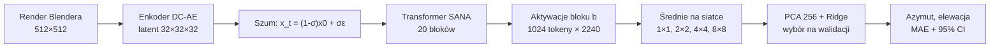
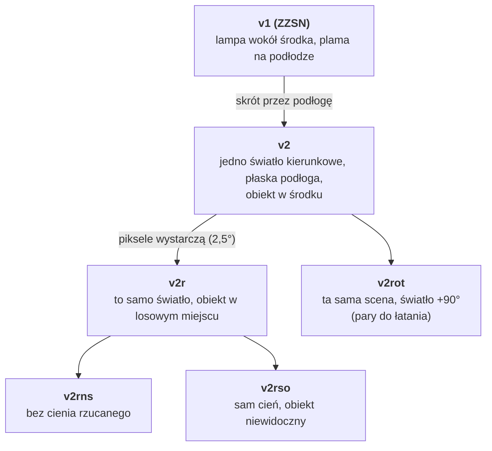
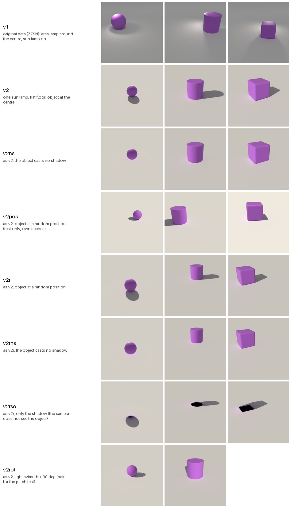
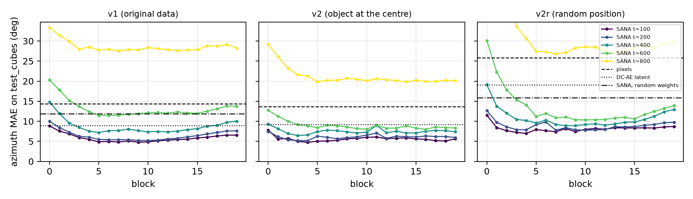
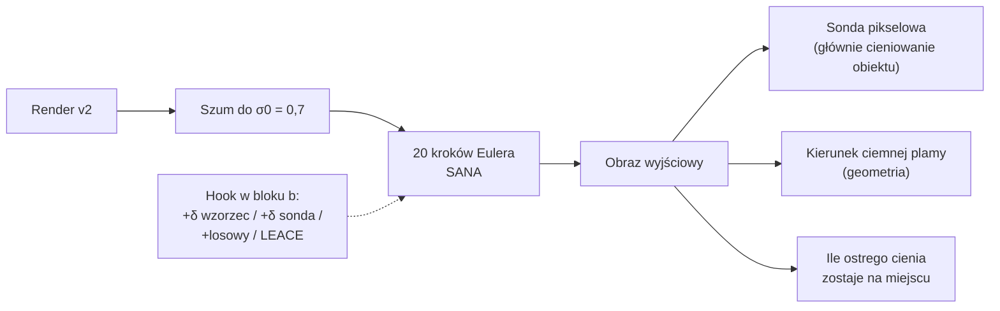
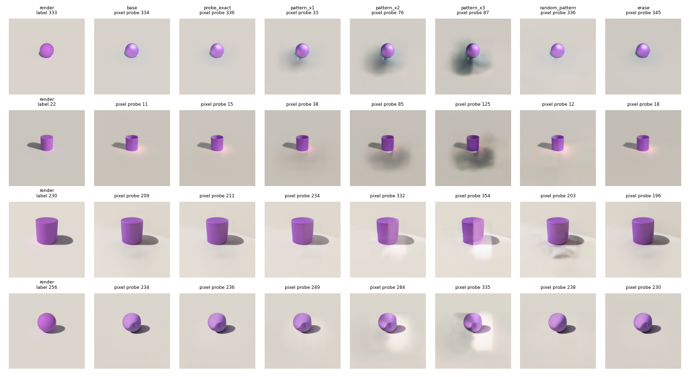
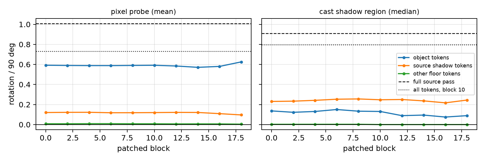

# Stan prac: czy SANA „wie”, skąd pada światło? (16.10.2026)

Krótki przegląd dla prowadzącego: pytanie, co już wiemy, co pokazały eksperymenty i co dalej. Pełne szczegóły są w `docs/PODSUMOWANIE.md`, a artykuł w `docs/article/main.tex` (PDF: `docs/article/build/main.pdf`).

---

## 1. Pytanie i metoda

Czy aktywacje modelu tekst→obraz **SANA-1.6B** zawierają kierunek światła sceny 3D w formie, której **nie ma wprost w pikselach**? Czy model tej informacji **używa** przy generowaniu obrazu?

Narzędziem jest liniowa sonda (PCA, potem regresja Ridge) na uśrednionych aktywacjach bloku $b$ transformera przy kroku szumu $t$:

$$
\hat{\mathbf y} = W\,\mathrm{PCA}_{256}\big(h_b(x_t)\big) + c
$$

$$
\mathbf y = [\sin\varphi,\ \cos\varphi,\ \theta], \qquad \hat\varphi = \operatorname{atan2}(\hat y_1, \hat y_2)
$$

gdzie $\varphi$ to azymut, a $\theta$ elewacja światła. Błąd azymutu liczymy kołowo: $e = \min(|\hat\varphi-\varphi|,\ 360^\circ - |\hat\varphi-\varphi|)$. Model dostaje obraz zaszumiony regułą przepływu, na której był trenowany: $x_t = (1-\sigma)\,x_0 + \sigma\,\varepsilon$, $\sigma = t/1000$.

Każdy wynik ma te same kontrole: piksele (najlepsza z siatek 8, 16, 32, 64), latent DC-AE, SANA z losowymi wagami, zadanie kontrolne z przetasowanymi etykietami oraz dwa inne modele (SD 1.5, SDXL). Blok, krok $t$ i siatkę wybiera wyłącznie zbiór walidacyjny.

---

## 2. Co ustalił audyt starego projektu (ZZSN)

| Ustalenie | Liczby |
|---|---|
| Stary wynik **nie bił pikseli** | sześciany: SANA 14,0°, ta sama sonda na pikselach 14,1° |
| W starym kodzie **szum był błędny** (pułapka w diffusers, zgłoszona jako issue #15021) | dla t = 200 model dostawał $-24{,}5\,x_0 + 25{,}5\,\varepsilon$ zamiast $0{,}8\,x_0 + 0{,}2\,\varepsilon$ |
| Etykieta to **pozycja lampy**, a nie światło przy obiekcie | różnica średnio 35° w azymucie |
| Sondę niosła **plama światła na podłodze** | sama podłoga 9,4°, sam obiekt 44,3° (sześciany) |

**Nowe (15.10):** na tych samych danych v1 poprawiony pipeline daje dla SANA **4,8°** na sześcianach, a najlepsze piksele 12,8°. Ze starym szumem wychodzi 14,5°, czyli stary wynik się odtwarza. **To błędny szum ukrył informację, którą model ma.**

---

## 3. Dane

Wszystkie zbiory są gotowe (po 3000 obrazów, v2pos 300, v2rot 48 par). Dane leżą na Kaggle, a w repo są etykiety, splity i po 3 przykłady każdej wersji. Plansza poniżej pokazuje te same sceny w każdej wersji:

---

## 4. Wyniki sond: kierunek światła jest w cechach, a nie w pikselach

Błąd azymutu (°) na teście (kule i walce) i na sześcianach, których sonda nie widziała. Konfiguracja wybrana na walidacji, w nawiasie 95% CI na sześcianach.

| Zbiór | Piksele (najlepsza siatka) | Latent DC-AE | SANA, losowe wagi | **SANA** | SD 1.5 | SDXL |
|---|---:|---:|---:|---:|---:|---:|
| v1 (stare dane) | 9,6 / 12,8 | 7,3 / 8,9 | 11,5 / 11,9 | **4,1 / 4,8** [4,6; 5,1] | 5,1 / 6,9 | 5,4 / 6,0 |
| v2 (obiekt w środku) | 2,5 / 13,7 | 2,2 / 9,2 | — | **2,2 / 7,3** [7,0; 7,7] | 3,3 / 8,9 | — |
| **v2r (losowa pozycja)** | 21,5 / 20,1 | 18,8 / 19,0 | 11,9 / 15,9 | **5,4 / 7,6** [7,3; 8,0] | 7,5 / 11,1 | 5,9 / 7,3 |
| v2rns (bez cienia) | 24,6 / 23,3 | 29,0 / 30,7 | — | **6,9 / 9,9** [9,4; 10,4] | — | — |
| v2rso (sam cień) | 24,6 / 16,9 | 15,7 / 17,8 | — | **5,9 / 7,9** [7,6; 8,3] | — | — |

Wnioski:
1. **Na v2r SANA jest lepsza od najlepszych pikseli o 12,5°** na sześcianach (CI [11,1; 13,8]). SDXL i SD 1.5 dają podobny efekt, więc to cecha modeli dyfuzyjnych, a nie jednego modelu.
2. **Część efektu daje sama architektura:** SANA z losowymi wagami też bije piksele (15,9°). Trening zmniejsza ten błąd mniej więcej o połowę.
3. **Najlepsze są wczesne i środkowe bloki (4–10) przy najmniejszym szumie** (t = 100).
4. **Kod nie zależy od pozycji.** Średnia wszystkich tokenów (siatka 1×1) daje 5,9° na v2r. Sonda uczona tylko na obiektach w środku (v2) daje na obiektach w losowych miejscach 9,0° / 17,6°, a piksele 71°.
5. **Model czyta obie wskazówki osobno:** samo cieniowanie obiektu (v2rns) i sam cień (v2rso). Sonda z pełnych scen przenosi się na sceny z jedną wskazówką częściowo (ok. 30–33°, piksele ok. 73–75°).
6. Zadanie kontrolne (przetasowane etykiety) daje 83–93°, więc sondy nie dopasowują szumu.

---

## 5. Test przyczynowy: czy model **używa** kierunku

Wynik mierzą trzy miary:
- **sonda pikselowa**: czyta kierunek z całego obrazu, w praktyce głównie z cieniowania obiektu;
- **kierunek ciemnej plamy** na podłodze (geometria, bez uczenia);
- **ile ostrego cienia zostaje**: jaka część pikseli ostrego cienia z wyjścia bez zmiany jest dalej cieniem. 1 oznacza, że cień stoi; przy cieniu obróconym o 90° wychodzi ok. 0.

Wyniki dla celu +90° i 60 obrazów (bloki 4 / 10 / 18):

| Warunek | Sonda pikselowa | Kierunek ciemnej plamy | Ostry cień zostaje |
|---|---:|---:|---:|
| **wzorzec ×1** (zmiana 2% normy tokenu) | **+65° / +60° / +62°** | +7° / +7° / +5° | 0,68 / 0,73 / 0,80 |
| wzorzec ×3 | +121° / +121° / +120° | +109° / +107° / +92° | 0,32 / 0,34 / 0,40 |
| losowy wektor tej samej wielkości | ok. 0° | ok. 0° | 0,82–0,88 (poziom „bez efektu”) |
| najkrótsza zmiana odczytu sondy | +41° / +23° / +40° | +1° do +4° | 0,74–0,89 |
| wymazanie LEACE | 0° | 0° | 0,93–0,99 |

Dodatkowe przebiegi:
- **Blok 5 z cechami z t = 100** (najlepiej odczytywalne): dawki ×1 / ×2 / ×3 dają w sondzie +30° / +79° / +105°. Ostry cień zostaje w 0,76 / 0,55 / 0,41.
- **Większy szum** (σ0 = 0,85 i 0,95): cieniowanie nadal idzie za wzorcem (+63° przy 0,85), a ciemna plama się nie obraca (−9°). Słaba reakcja cienia nie wynika więc tylko z tego, że wejście „trzyma” stary cień.

Wnioski:
1. **Kierunek „wzorca” jest przyczynowy:** mała zmiana wzdłuż niego zmienia światło na obrazie, a losowa zmiana tej samej wielkości nie robi nic.
2. **Przy naturalnej dawce zmienia się cieniowanie obiektu, a ostry cień rzucany zostaje na miejscu.**
3. **Duża dawka nie rysuje nowego cienia.** Usuwa część starego i przyciemnia podłogę w stronę celu, co widać na przykładach.
4. **Wagi sondy są słabym uchwytem**, zgodnie z Haufe i in. (2014).
5. **Wymazanie w jednym bloku nic nie zmienia.** Zaszumione wejście nadal pokazuje cień i cieniowanie, więc model może odczytać kierunek z nich ponownie.

---

## 6. Łatanie aktywacji: skąd model bierze cień

Dla 48 par scen (ta sama scena, światło +90°) podmieniamy w jednym bloku tokeny jednego obszaru wartościami ze sceny źródłowej:

| Co podmieniamy | Sonda pikselowa (część obrotu) | Ostry cień celu zostaje | Ostry cień źródła się pojawia |
|---|---:|---:|---:|
| pełny przebieg źródła | 1,01 | 0,14 | 1,00 |
| wszystkie tokeny, blok 10 | 0,73 | 0,16 | 0,84 |
| tokeny obiektu (ok. 10% obrazu), każdy blok 0–18 | 0,57–0,63 | 0,60–0,67 | **0,33–0,38** |
| tokeny cienia źródła | 0,10–0,12 | 0,92 | 0,59 (podwójny cień) |
| reszta podłogi (poziom odniesienia) | 0,01 | 0,96 | 0,12 |

**Tokeny obiektu niosą cieniowanie obiektu i część cienia rzucanego:** z ich podmiany pojawia się ok. jedna trzecia cienia źródła, a jedna trzecia starego cienia znika. Cały cień przenosi dopiero podmiana wszystkich tokenów. Model składa więc cień częściowo z informacji przy obiekcie, a częściowo z reszty obrazu. Wynik jest taki sam w każdym bloku, bo podmiana tokenu zastępuje cały jego stan.

---

## 7. Co z tego wynika

| Pytanie | Odpowiedź |
|---|---|
| Czy stary wynik dowodził wiedzy o świetle? | Nie: piksele były równie dobre (skrót przez podłogę), a błędny szum ukrył informację w modelu. |
| Czy SANA ma kierunek światła w cechach ponad to, co dają piksele? | **Tak**, wyraźnie, na scenach bez skrótów; podobnie SD 1.5 i SDXL. |
| Czy ten kod zależy od pozycji obiektu w kadrze? | Nie. |
| Czy model go używa? | **Tak, do cieniowania obiektu.** Przesunięcie wzdłuż kodu nie rysuje nowego cienia rzucanego; tokeny przy obiekcie niosą tylko część cienia. |

Do tego dochodzą lista kontrolna dla badań sondami i poprawka do biblioteki diffusers.

---

## 8. Co dalej

- **Artykuł:** wszystkie wyniki są wpisane (`docs/article/main.tex`, format TMLR, 16 stron z dodatkami). Do zrobienia: końcowy przegląd i decyzja o miejscu zgłoszenia (TMLR jest otwarty cały czas).
- **Interaktywny podgląd** (obrót kierunku w cechach i przeszczep tokenów, trzy miary): `tools/viewer/`, opublikowany jako strona.
- **Pytania do prowadzącego:** zespół 2 osoby zamiast 3, kontynuacja projektu z ZZSN, zasady oceny.

Obliczenia idą na Kaggle; lista wszystkich jobów i danych jest w `docs/KAGGLE_DATA.md`, a instrukcja w `docs/KAGGLE_RUNBOOK.md`. W tym tygodniu GPU: ok. 27 z 30 h.
