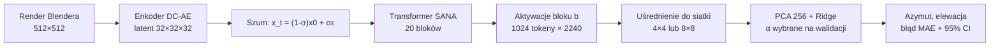
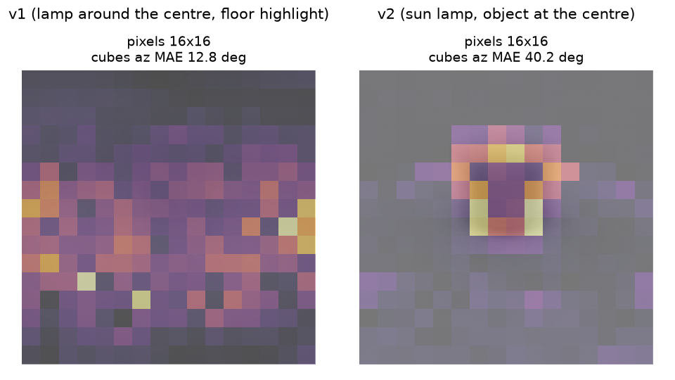
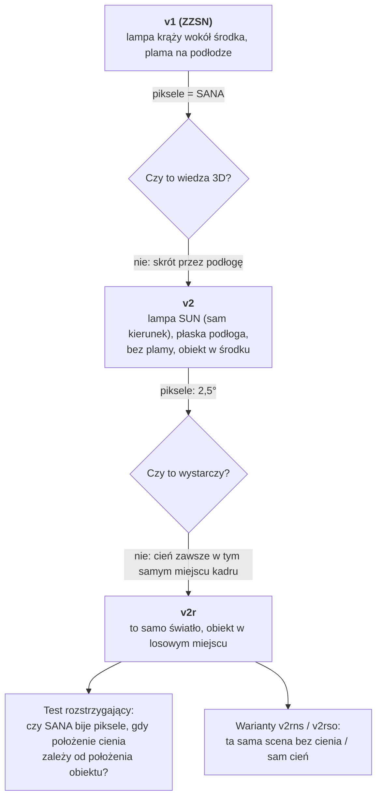
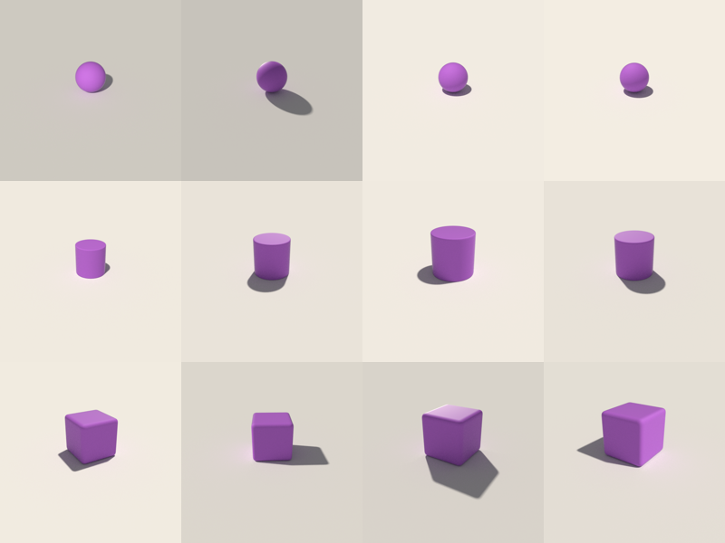
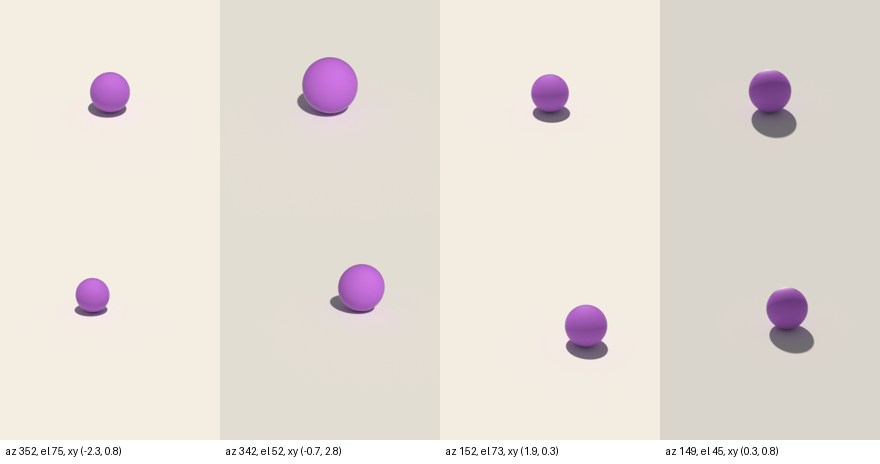
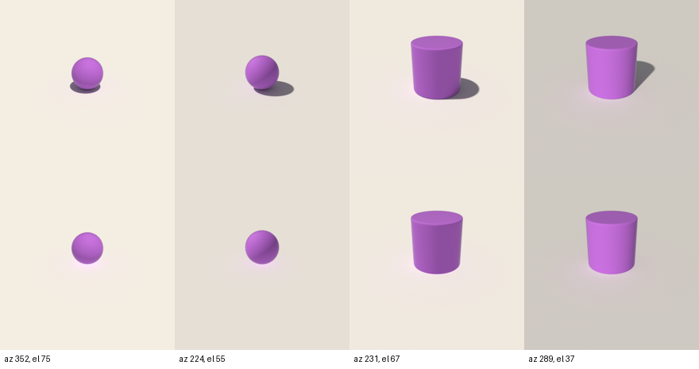
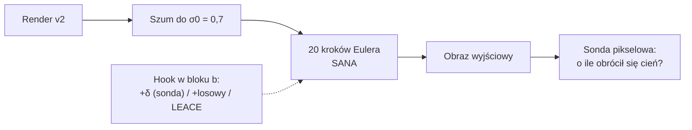
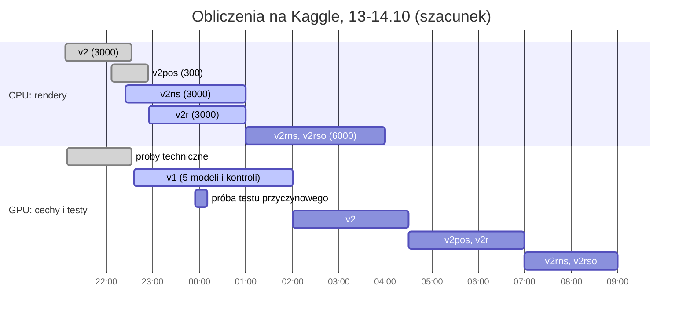

# Stan prac: czy SANA „wie”, skąd pada światło? (13.10.2026, 23:50)

Krótki przegląd dla prowadzącego: co sprawdzamy, co już wiemy, co się teraz liczy i co rozstrzygnie wynik. Pełne szczegóły są w `docs/PODSUMOWANIE.md`.

---

## 1. Pytanie i metoda w jednym zdaniu

Czy aktywacje modelu tekst→obraz **SANA-1.6B** zawierają kierunek światła sceny 3D w formie, której **nie ma już wprost w pikselach**, i czy model tej informacji **używa**?

Narzędziem jest liniowa sonda (PCA, potem regresja Ridge) na uśrednionych aktywacjach bloku $b$ transformera, przy kroku szumu $t$:

$$
\hat{\mathbf y} = W\,\mathrm{PCA}_{256}\big(h_b(x_t)\big) + c
$$

$$
\mathbf y = [\sin\varphi,\ \cos\varphi,\ \theta], \qquad \hat\varphi = \operatorname{atan2}(\hat y_1, \hat y_2)
$$

gdzie $\varphi$ to azymut, a $\theta$ elewacja światła. Błąd azymutu liczymy kołowo: $e = \min(|\hat\varphi-\varphi|,\ 360^\circ - |\hat\varphi-\varphi|)$.

Model dostaje obraz zaszumiony regułą przepływu (*flow matching*), na której był trenowany:

$$
x_t = (1-\sigma)\,x_0 + \sigma\,\varepsilon,\qquad \sigma = t/1000,\qquad \varepsilon\sim\mathcal N(0, I)
$$

---

## 2. Co już wiemy

| Ustalenie | Liczby |
|---|---|
| Wynik z ZZSN (SANA, blok 10, t = 200) **nie bije pikseli** | sześciany: SANA 14,0°, ta sama sonda na pikselach 14,1° |
| W starym kodzie **szum był błędny** (pułapka w bibliotece diffusers, zgłoszona jako issue #15021) | dla t = 200 model dostawał $-24{,}5\,x_0 + 25{,}5\,\varepsilon$ zamiast $0{,}8\,x_0 + 0{,}2\,\varepsilon$ |
| Etykieta to **pozycja lampy wokół środka sceny**, a nie światło przy obiekcie | różnica średnio 35° w azymucie |
| Sondę niosła **plama światła na podłodze**, nie obiekt | sama podłoga 9,4°, sam obiekt 44,3° (sześciany) |
| Nowy pipeline **odtwarza stary** we wszystkim poza szumem | norma tokenu ze starym szumem: 11 147 (stare dane: ok. 11 100), z poprawnym: 718 |

Gdzie sonda pikselowa czyta kierunek (dokładny rozkład sondy liniowej na komórki obrazu; jaśniej = większy udział):

Na starych danych (v1) waga leży na całej podłodze, gdzie wędruje plama od lampy.

---

## 3. Dlaczego powstały nowe dane

| Zbiór | Co zmienia | Liczba obrazów | Stan |
|---|---|---:|---|
| v2 | jedno światło kierunkowe, płaska podłoga, obiekt w środku | 3000 | gotowy |
| v2pos | jak v2, obiekt w losowym miejscu (tylko test) | 300 | gotowy |
| v2ns | jak v2, obiekt nie rzuca cienia | 3000 | 4 z 6 części |
| **v2r** | jak v2 (to samo światło, obraz w obraz), obiekt w losowym miejscu | 3000 | renderuje się |
| v2rns, v2rso | jak v2r: bez cienia / sam cień | 2 × 3000 | w kolejce |

Ta sama scena i to samo światło: v2 (góra, obiekt w środku) i v2r (dół, obiekt w losowym miejscu):

Pozycja w v2r jest losowana tylko tam, gdzie największy obiekt mieści się cały w kadrze. Ten obszar zależy wyłącznie od kamery, więc pozycja nie koreluje ze światłem ($|r| < 0{,}01$).

---

## 4. Pierwsze wyniki na nowych danych (tylko piksele)

| Sonda na pikselach 64×64 | Kule i walce | Sześciany |
|---|---:|---:|
| v2: uczona i testowana na v2 | **2,5°** | 13,7° |
| v2: test na obiektach w losowych miejscach (v2pos) | **69,0°** (losowo: 90°) | |
| uczona na v2, test na **tych samych scenach bez cienia** | **77,4°** | |
| uczona i testowana na v2ns (samo cieniowanie obiektu) | 4,2° | |

Ta sama scena z cieniem (góra) i bez cienia (dół):

Wnioski:
1. Przy obiekcie w środku **piksele wystarczają** do kierunku (2,5°). Na takim zbiorze nie da się pokazać przewagi modelu.
2. Sonda pikselowa **opiera się na cieniu**: po jego usunięciu błąd rośnie z 2,5° do 77°.
3. Piksele **nie przenoszą** kierunku na nowe pozycje (69°). To jest próg, który SANA musi pobić na v2r.
4. **Elewację zdradza jasność podłogi** (1,7° z samej podłogi), więc główną miarą jest azymut.

---

## 5. Kontrole: co każda wyklucza

| Kontrola | Co wyklucza, jeśli SANA jest wyraźnie lepsza |
|---|---|
| ta sama sonda na **pikselach** | informacja jest w obrazie w prostej, liniowej formie |
| ta sama sonda na **latencie DC-AE** | informację daje już enkoder obrazu, a nie transformer |
| SANA z **losowymi wagami** | wynik daje sama architektura, a nie uczenie |
| SANA ze **starym szumem** | wynik ZZSN był artefaktem złego szumu |
| **SD 1.5 i SDXL** | wynik jest cechą jednego modelu |
| wybór bloku i $t$ **tylko na walidacji**, 95% CI z bootstrapu | dopasowanie do zbioru testowego |

---

## 6. Test przyczynowy: czy model *używa* kierunku

Sonda pokazuje tylko, że informację da się odczytać. Żeby sprawdzić, czy model jej używa, zmieniamy aktywacje podczas generowania obrazu i patrzymy, czy przesuwa się cień.

1. Render v2 kodujemy, zaszumiamy do $\sigma_0 = 0{,}7$ i odszumiamy w 20 krokach Eulera (SDEdit): $x_{\sigma'} = x_\sigma + (\sigma' - \sigma)\,v_\theta(x_\sigma, \sigma)$.
2. W każdym kroku hook w bloku $b$ zmienia tokeny na jeden z trzech sposobów:
   - **przesunięcie wzdłuż sondy** do azymutu $\varphi + 90^\circ$, najkrótszym wektorem: $\delta = W^\top (W W^\top)^{-1} \Delta\mathbf y$, przeskalowanym przez $s \in \{1, 4, 16\}$;
   - **losowe przesunięcie** o tej samej normie (kontrola);
   - **wymazanie LEACE**: $r(h) = h - A\,(h - \mu)$; po nim żadna funkcja liniowa nie koreluje z $(\sin\varphi, \cos\varphi)$.
3. Azymut obrazu wyjściowego mierzy sonda pikselowa.

Jeśli kierunek jest przyczynowy, przesunięcie wzdłuż sondy obraca cień w stronę celu i bardziej niż przesunięcie losowe. Jeśli model go używa, wymazanie psuje zgodność cienia z etykietą.

---

## 7. Co się teraz liczy

Wszystko liczy się na Kaggle (klaster Athena wyczerpał przydział GPU). Kolejka sama wysyła joby (najwyżej 5 CPU i 2 GPU naraz) i pobiera wyniki, a automat na laptopie sam liczy sondy, gdy zestaw jest kompletny. Czasy poniżej to szacunek.

Zużycie GPU: ok. 20 h z tygodniowego limitu 30 h na jednym koncie.

---

## 8. Co rozstrzygnie wynik

| Wynik na v2r (sześciany i nowe pozycje) | Wniosek do artykułu |
|---|---|
| SANA **wyraźnie lepsza** od pikseli, latentu i losowych wag, a przesunięcie wzdłuż sondy obraca cień | model ma **reprezentację kierunku światła niezależną od pozycji** i jej używa (wynik pozytywny, przyczynowy) |
| SANA lepsza od kontroli, ale przesunięcie nic nie zmienia | informacja jest w modelu, ale ten kierunek nie steruje cieniem (reprezentacja „uboczna”) |
| SANA **nie lepsza** od kontroli | brak dowodu na wiedzę 3D; wynik negatywny z pełnymi kontrolami (wartościowy dla TMLR) |

W każdym z trzech przypadków powstaje artykuł z jasną tezą. Do tego dochodzą lista kontrolna dla badań sondami i poprawka do biblioteki diffusers.
